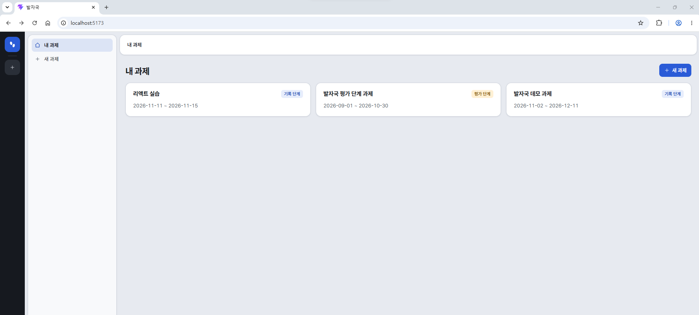
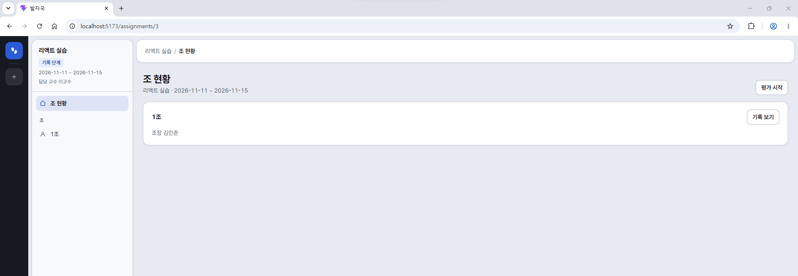

# 1차 미션 - 윤장현

## 질문 1
5. 



## 질문 2

2. AssignmentCreatePage.jsx 139줄

```jsx
<button type="button" className="btn primary" onClick={handleSubmit} disabled={submitting}>등록</button>
```

3. AssignmentCreatePage.jsx 50줄
```jsx
createAssignment({ title, startDate, endDate, leaderEmails })
```

4. 
`import { createAssignment } from '../api/assignments'`

## 질문 3

2. 
입력값이 올바르지 않습니다

3. 
백엔드 쪽에서는 보이지만 프론트엔드 쪽에서는 없습니다.

4. 
프론트엔드 파일에 해당 문장이 없고 서버상에서만 보이는 경우는 서버가 보내준 것이라고 판단하면 됩니다.

5. AssignmentCreatePage.jsx 68줄
```jsx
{error && <div className="errband" role="alert">{error}</div>}
```