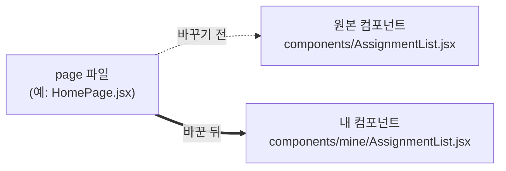
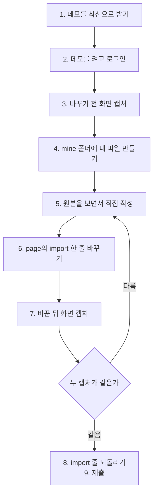
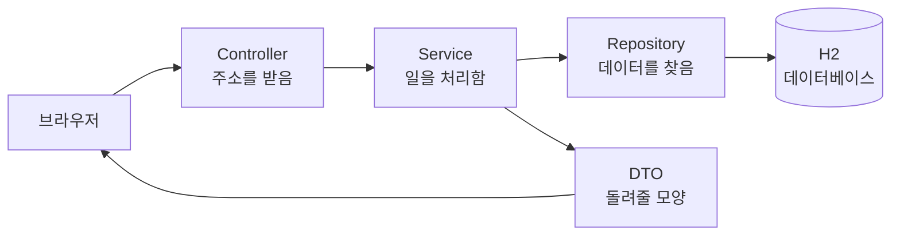
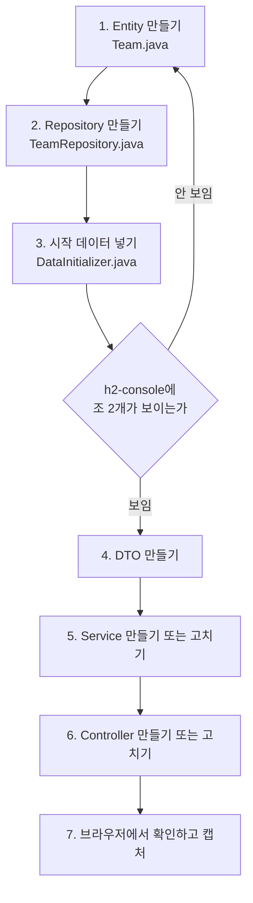

# 3차 미션: 직접 만들기 (11.18 ~ 11.22)

> **이번 주 할 일**
>
> - 프론트엔드: 컴포넌트 1개를 직접 만듭니다.
> - 백엔드: API 1개를 직접 만듭니다.
> - 데모의 작은 부분을 직접 만들면서 손에 익히는 연습 단계입니다.
> - **모두 꼭 해야 하는 과제입니다.** 이전 미션에서 못 낸 것은 내지 않아도 됩니다.
> - 마감: **11월 22일(일) 밤 11시 59분**

## 0. 한눈에 보기

| 이름 | 쪽 | 만들 것 | 성공 기준 | 내 카드 |
|---|---|---|---|---|
| 윤장현 | 프론트엔드 | `AssignmentList.jsx` (내 과제 목록) | 바꾸기 전 화면 = 바꾼 뒤 화면 | [열기](cards.md#윤장현) |
| 김효민 | 프론트엔드 | `RecentDeliverableList.jsx` (조 홈의 최근 산출물) | 바꾸기 전 화면 = 바꾼 뒤 화면 | [열기](cards.md#김효민) |
| 양원야 | 프론트엔드 | `EvaluationTargets.jsx` (동료평가에서 조원 고르기) | 바꾸기 전 화면 = 바꾼 뒤 화면 | [열기](cards.md#양원야) |
| 이종민 | 백엔드 | `GET /assignments/{id}`에 조 목록 붙이기 | 브라우저에 조 목록이 나옴 | [열기](cards.md#이종민) |
| 장호진 | 백엔드 | `GET /teams/join/{inviteCode}` 만들기 | 브라우저에 과제 이름과 조 이름이 나옴 | [열기](cards.md#장호진) |

모두 2차 미션에서 맡은 기능 안의 일입니다.

각자 맞는 항목만 읽으세요.
- 프론트엔드: [1. 규칙](#1-규칙) → [2. 프론트엔드](#2-프론트엔드) → 내 카드 → [4. 제출](#4-제출)
- 백엔드: [1. 규칙](#1-규칙) → [3. 백엔드](#3-백엔드) → 내 카드 → [4. 제출](#4-제출)

## 1. 규칙

| 규칙 | 이유 |
|---|---|
| 원본을 보면서 만들되, 복사해서 붙여 넣지 말고 직접 입력하세요. | 직접 입력해야 한 줄씩 읽게 됩니다. |
| 코드 묶음마다 원본 주석을 옮기지 말고 내 말로 주석을 다세요. | 주석에 내가 이해한 만큼이 드러납니다. |
| 모르는 줄을 AI에게 물어보는 것은 괜찮지만, 코드 전체를 맡기지는 마세요. | 이번 목표는 내 손으로 만들어 보는 것입니다. |
| 막히면 단체방에 질문하고, 오류는 화면을 캡처해서 올리세요. | 오류 화면이 있어야 빨리 답할 수 있습니다. |
| 다 못 만들었어도 만든 부분까지 올리세요. | 막힌 곳을 알아야 다음 계획을 정합니다. |

## 2. 프론트엔드

### 2-1. 할 일

데모 화면의 한 부분(컴포넌트)을 직접 다시 만들고, 데모가 원본 대신 내 파일을 쓰게 바꿉니다.

**바꾸기 전 화면 = 바꾼 뒤 화면** 이면 성공입니다.

page 파일에서 바꾸는 곳은 import 한 줄뿐입니다.



원본은 그대로 두고 내 파일만 `mine` 폴더에 따로 만들어서, import 줄만 되돌리면 원래대로 돌아갑니다.

```
footprint-demo/
└── frontend/
    └── src/
        ├── pages/
        │   └── HomePage.jsx            ← import 한 줄만 바꿈
        └── components/
            ├── AssignmentList.jsx      ← 원본 (보기만)
            └── mine/                   ← 새 폴더
                └── AssignmentList.jsx  ← 내가 만드는 파일
```

※ 윤장현의 예이고, 내 파일 이름은 내 카드에 있습니다.

#### 데모 구조 = 예시 프로젝트 구조

1단계에서 공부한 예시 프로젝트(`example/frontend`)에서 page와 컴포넌트 수만 늘어난 것이 데모입니다.

| 하는 일 | 예시 프로젝트 | 데모 |
|---|---|---|
| 주소를 page에 연결 | `App.jsx` | `App.jsx` |
| 데이터를 불러와서 컴포넌트에 넘김 | `pages/AssignmentPage.jsx` | `pages/` 안의 page 파일들 |
| 서버에 요청 | `api/assignments.js` | `api/` 안의 파일들과 `api/client.js` |
| 화면의 한 부분을 그림 | `components/AssignmentList.jsx` | `components/` 안의 파일들 |

다른 점은 두 가지입니다.

| | 예시 프로젝트 | 데모 |
|---|---|---|
| 주소와 page | page 1개. `App.jsx`가 그 page를 바로 그림 | page 여러 개. `App.jsx`가 주소마다 page를 고름 (`Route`) |
| 서버 요청 | `api` 파일에서 `fetch`를 바로 부름 | 로그인 정보(token)를 붙이려고 `api/client.js`를 거침 |

내 컴포넌트가 이 흐름의 어디에 붙는지는 내 카드의 **내 위치** 항목에 있습니다.

### 2-2. 순서



**1. 데모를 최신으로 받기**

데모 폴더의 터미널에서 입력합니다.

```
git pull
```

오류가 나면 아래를 입력해서 1차 미션 때 바뀐 가짜 데이터를 처음 상태로 돌린 뒤, 다시 `git pull`을 합니다.

```
git restore .
```

데모 폴더가 없으면 [1차 미션 안내 2-2](../../docs/mission1.md#2-2-데모를-내-컴퓨터로-복사하기)부터 합니다.

**2. 데모를 켜고 로그인하기**

[1차 미션 안내 2-3, 2-4, 2-5](../../docs/mission1.md#2-3-가짜-api-켜기)와 같고, 계정은 내 카드에 있습니다.

**3. 바꾸기 전 화면 캡처**

내 카드의 주소로 들어가서 내 컴포넌트가 보이게 캡처하고, `before.png`로 저장합니다.

**4. `mine` 폴더에 내 파일 만들기**

VS Code 왼쪽 파일 목록에서 `frontend/src/components`를 오른쪽 클릭 → [새 폴더]로 `mine` 폴더를 만들고, 그 안에 원본과 **같은 이름**의 파일을 만듭니다.

**5. 원본을 보면서 직접 작성**

원본과 내 파일을 나란히 열면 편합니다. (원본 탭을 오른쪽 클릭 → [오른쪽으로 분할])

`mine` 폴더가 한 단계 안쪽이라서 import 경로만 다르게 씁니다.

| 원본 | 내 파일 |
|---|---|
| `'../format'` | `'../../format'` |
| `'../constants/...'` | `'../../constants/...'` |
| `'react-router'` | `'react-router'` (그대로) |

**6. page의 import 한 줄 바꾸기**

내 카드에 적힌 줄에서 `components/` 뒤에 `mine/`만 넣으면 됩니다.

```
바꾸기 전: import AssignmentList from '../components/AssignmentList'
바꾼 뒤:   import AssignmentList from '../components/mine/AssignmentList'
```

**7. 바꾼 뒤 화면 캡처**

저장하면 저절로 바뀌는 화면을 3번과 같은 주소에서 캡처하고, `after.png`로 저장합니다.

**8. import 줄 되돌리기**

6번에서 넣은 `mine/`을 지워서 데모를 원래 상태로 둡니다.

**9. 제출** → [4. 제출](#4-제출)

### 2-3. 막혔을 때

| 화면에 나온 것 | 이유 | 할 일 |
|---|---|---|
| `Failed to resolve import "../format"` | `mine` 폴더 안이라 경로가 한 단계 더 깊음 | `'../format'` → `'../../format'` |
| 화면이 하얗고, F12 → [Console]에 `does not provide an export named 'default'` | 파일 맨 아래 `export default` 줄이 없음 | 원본 마지막 줄을 보고 같은 줄을 씀 |
| 화면 전체가 하얗게 나옴 | 내 코드에 오류가 있음 | 브라우저에서 F12 → [Console] 탭의 빨간 글자를 캡처해서 단체방에 올림 |
| [로그인]을 눌러도 넘어가지 않거나, 데이터가 안 나옴 | 가짜 API가 꺼짐 | 가짜 API 터미널에서 `npm run mock`을 다시 입력 |

## 3. 백엔드

### 3-1. 할 일

`example/backend` 예시 프로젝트에 **조(team) 테이블**을 붙이고 API 1개를 만듭니다.

요청은 아래처럼 흐르고, 파일마다 맡은 일이 하나씩 있습니다.



새로 만드는 파일은 예시의 `Assignment` 파일과 같은 폴더에 같은 모양으로 만들고, 본보기로 삼을 파일은 내 카드의 **내 위치** 항목에 있습니다.

#### H2를 쓰는 이유

- H2: 따로 설치하지 않고 프로그램 안에서 실행되는 데이터베이스입니다.
- 데이터를 메모리에 두어서, 서버를 끄면 지워지고 다시 켜면 `DataInitializer`가 시작 데이터를 넣습니다.
- 이번 주 목표는 JPA 연습이라서 PostgreSQL 설치와 연결은 다루지 않습니다.
- Entity와 Repository 코드는 PostgreSQL을 쓸 때와 같습니다.

### 3-2. 준비: 예시 프로젝트를 H2로 실행하기

**1. 예시 프로젝트 복사**

최신 footprint-study 저장소(`git pull`, 또는 GitHub에서 [Code] → [Download ZIP])에서 `example/backend` 폴더를 통째로 **저장소 밖**의 아무 폴더에 복사하고, 이름을 `mission3-backend`로 바꿉니다.

```
아무 폴더/
└── mission3-backend/                     ← example/backend를 복사한 것
    ├── build.gradle                      ← 2번에서 한 줄 바꿈
    ├── settings.gradle                   ← 2번에서 이름 바꿈
    └── src/main/
        ├── java/com/footprint/backend/   ← 내 카드의 파일을 여기에 만듦
        └── resources/
            └── application.yml           ← 3번에서 바꿈
```

**2. Gradle 설정 2줄 바꾸기**

`settings.gradle`

```
rootProject.name = 'mission3-backend'
```

`build.gradle`

```
바꾸기 전: runtimeOnly 'org.postgresql:postgresql'
바꾼 뒤:   runtimeOnly 'com.h2database:h2'
```

**3. `application.yml` 바꾸기**

`src/main/resources/application.yml`의 내용을 전부 지우고, 들여쓰기(앞의 빈칸)까지 똑같이 맞춰서 아래를 넣습니다.

```yaml
spring:
  datasource:
    url: jdbc:h2:mem:footprint
    username: sa
    password:
  h2:
    console:
      enabled: true
  jpa:
    hibernate:
      ddl-auto: create
    show-sql: true
    properties:
      hibernate:
        format_sql: true
```

**4. 실행**

IntelliJ에서 `mission3-backend` 폴더를 열고, 편집 화면 오른쪽 위에 코끼리 모양 버튼(Gradle 설정 다시 읽기)이 보이면 누른 뒤 `BackendApplication`을 실행합니다.

**5. 준비 확인**

| 주소 | 나와야 하는 것 |
|---|---|
| `http://localhost:8080/assignments` | 과제 3건 |
| `http://localhost:8080/h2-console` | H2 로그인 화면 |

H2 로그인 화면에 아래처럼 넣고 [Connect]를 누르면 테이블을 직접 볼 수 있습니다.

| 칸 | 넣을 값 |
|---|---|
| JDBC URL | `jdbc:h2:mem:footprint` |
| User Name | `sa` |
| Password | (비워 둠) |

### 3-3. 만들기 순서

내 카드의 파일을 아래 순서대로 만들면 중간에 확인하면서 갈 수 있습니다.



3번까지 했으면 서버를 다시 실행하고 h2-console에서 아래를 실행해서, 조 2개가 보이면 4번으로 갑니다.

```sql
SELECT * FROM TEAM;
```

### 3-4. 막혔을 때

| 화면에 나온 것 | 이유 | 할 일 |
|---|---|---|
| `Port 8080 was already in use` | 서버가 이미 하나 켜져 있음 | IntelliJ 아래쪽 [Run] 창의 빨간 네모 버튼으로 끄고 다시 실행 |
| `Cannot load driver class: org.h2.Driver` | H2가 아직 프로젝트에 안 들어옴 | 3-2의 2번(`build.gradle`) 확인 → 코끼리 버튼 |
| `Failed to configure a DataSource` | `application.yml`을 제대로 못 읽음 | 3-2의 3번 확인. 들여쓰기가 다르면 이 오류가 남 |
| h2-console에서 `Database ... not found` | JDBC URL이 다름 | `jdbc:h2:mem:footprint`를 그대로 넣음 |
| h2-console에 `TEAM` 테이블이 없음 | `Team.java`에 `@Entity`가 없거나, 서버를 다시 실행하지 않음 | `@Entity` 확인 → 서버 다시 실행 |
| 브라우저에 `Whitelabel Error Page`와 `404` | 브라우저 주소 ≠ Controller 주소 | `@RequestMapping`, `@GetMapping`의 주소와 브라우저 주소를 비교 |

## 4. 제출

1. footprint-study의 내 폴더(`members/내 폴더`) 안에 `mission3` 폴더를 만듭니다.
2. **내가 만들거나 고친 파일과 캡처만** 올리고, 프로젝트 폴더 통째로나 `node_modules`, `build` 폴더는 올리지 않습니다.
3. PR 제목을 `[이름] 3차 미션`으로 해서 PR로 올립니다.
4. PR을 올린 뒤 단체방에 "제출했습니다" 한 줄을 남깁니다.

프론트엔드 (윤장현의 예)

```
members/yoon/mission3/
├── AssignmentList.jsx   ← 내가 만든 파일
├── before.png           ← 바꾸기 전 캡처
└── after.png            ← 바꾼 뒤 캡처
```

백엔드 (이종민의 예)

```
members/jongmin/mission3/
├── Team.java                 ← 카드의 "새로" 파일 전부
├── TeamRepository.java
├── ...
├── DataInitializer.java      ← 카드의 "고침" 파일 전부
├── ...
└── result1.png, result2.png  ← 확인 주소마다 캡처 1장
```

---

※ 용어
- 컴포넌트: 화면의 한 부분을 그리는 함수
- page: 주소 하나에 해당하는 화면 전체. 여러 컴포넌트를 모아서 씀
- props: page가 컴포넌트에 넘겨주는 값
- H2: 설치 없이 프로그램 안에서 실행되는 데이터베이스
- Entity: 테이블의 한 줄과 대응하는 Java 클래스
- Repository: 데이터베이스에서 Entity를 저장하고 찾는 인터페이스
- DTO: 브라우저에 돌려줄 데이터의 모양을 정한 클래스
