# 3차 미션 카드

내 이름 카드만 읽으면 되고, 공통 순서는 [3차 미션 안내](README.md)에 있습니다.

| 프론트엔드 | 백엔드 |
|---|---|
| [윤장현](#윤장현) · [김효민](#김효민) · [양원야](#양원야) | [이종민](#이종민) · [장호진](#장호진) |

---

## 윤장현

**프론트엔드 / 내 과제 목록 (`AssignmentList.jsx`)**

로그인하면 처음 나오는 "내 과제" 화면에서 과제 상자를 그립니다. (2차 미션의 "과제 화면" 중 일부)

### 화면 속 위치

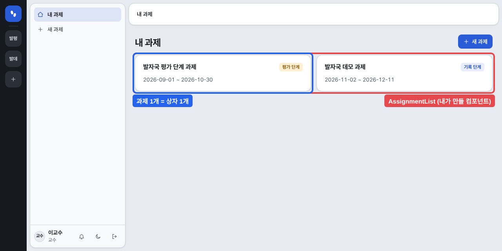

- 빨간 상자: 내가 만들 컴포넌트
- 파란 상자: 과제 1개 = 상자 1개

### 내 위치: 어디에서 이어지는가

회색 = 이미 있는 부분 (읽기만), 빨간색 = 내가 만드는 부분

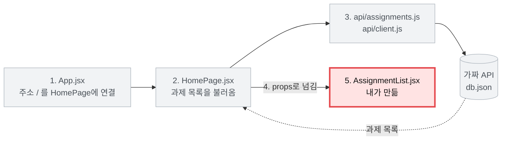

| 단계 | 데모 파일 | 예시 프로젝트에서 같은 역할 | 이번 미션 |
|---|---|---|---|
| 1. 주소를 page에 연결 | `App.jsx` 39번째 줄 | `App.jsx` | 읽기만 |
| 2. 데이터 불러오기 | `pages/HomePage.jsx` 21번째 줄 `getAssignments()` | `pages/AssignmentPage.jsx` 12번째 줄 | 읽기만 |
| 3. 서버에 요청 | `api/assignments.js` 10번째 줄 → `api/client.js` | `api/assignments.js` 3번째 줄 | 읽기만 |
| 4. props로 넘기기 | `pages/HomePage.jsx` 42번째 줄 | `pages/AssignmentPage.jsx` 26번째 줄 | 읽기만 |
| 5. 화면 그리기 | `components/AssignmentList.jsx` | `components/AssignmentList.jsx` | **직접 만듦** |

데모와 예시 프로젝트의 차이: [안내 2-1](README.md#2-1-할-일)

### 받는 값 (props)

| props | 들어 있는 값 | 예 |
|---|---|---|
| `assignments` | 과제 목록 (배열) | `[{ id: 1, title: "발자국 데모 과제", startDate: "2026-11-02", endDate: "2026-12-11", phase: "RECORDING", evaluationStartedAt: null }, ...]` |
| `isProfessor` | 로그인한 사람이 교수인지 | `true` 또는 `false` |

### 작업 정보

| 항목 | 내용 |
|---|---|
| 만들 파일 | `frontend/src/components/mine/AssignmentList.jsx` |
| 원본 | `frontend/src/components/AssignmentList.jsx` (31줄) |
| 바꿀 줄 | `frontend/src/pages/HomePage.jsx` 5번째 줄 |
| 계정 | `professor@example.com` (비밀번호 `pass1234`) |
| 주소 | `http://localhost:5173` |

```
바꾸기 전: import AssignmentList from '../components/AssignmentList'
바꾼 뒤:   import AssignmentList from '../components/mine/AssignmentList'
```

### 배우는 것

- [ ] 배열의 값 하나마다 상자 하나를 그립니다. (`map`, `key`)
  - 찾아볼 것: `React 리스트와 key`
- [ ] 목록이 비면 "아직 볼 수 있는 과제가 없습니다"와 안내 문장을 보여 줍니다. (교수용 안내 ≠ 학생용 안내)
  - 찾아볼 것: `React 조건부 렌더링`
- [ ] 상자를 누르면 그 과제의 주소로 갑니다. (`Link`)
  - 찾아볼 것: `react-router Link`

### 성공 확인

- [ ] 과제 이름, 단계, 기간이 들어간 과제 상자 2개가 보입니다.
- [ ] 상자를 누르면 그 과제로 갑니다.

---

## 김효민

**프론트엔드 / 조 홈의 최근 산출물 (`RecentDeliverableList.jsx`)**

조 홈에서 최근에 올라온 산출물을 최신순으로 보여 줍니다. (2차 미션의 "조 홈"과 "산출물 화면"이 만나는 곳)

### 화면 속 위치

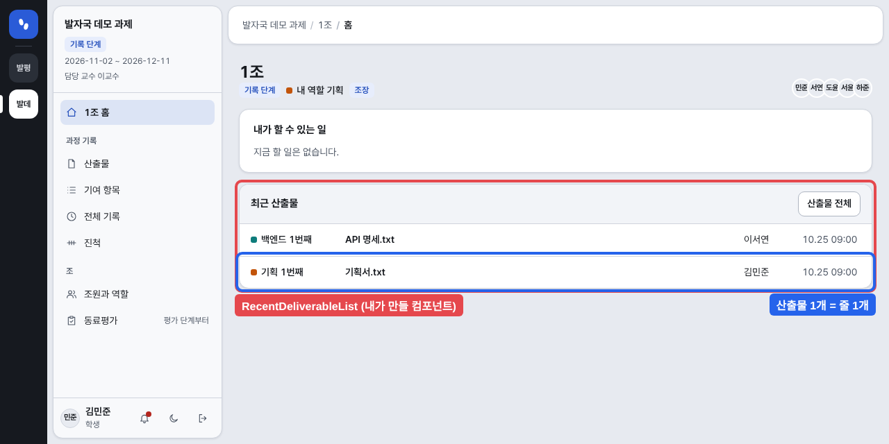

- 빨간 상자: 내가 만들 컴포넌트
- 파란 상자: 산출물 1개 = 줄 1개

### 내 위치: 어디에서 이어지는가

회색 = 이미 있는 부분 (읽기만), 빨간색 = 내가 만드는 부분

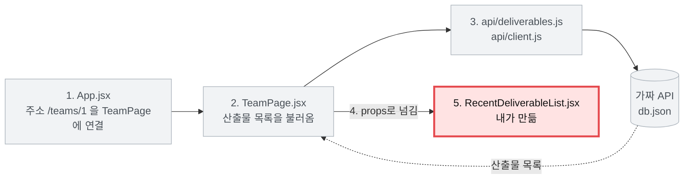

| 단계 | 데모 파일 | 예시 프로젝트에서 같은 역할 | 이번 미션 |
|---|---|---|---|
| 1. 주소를 page에 연결 | `App.jsx` 44번째 줄 | `App.jsx` | 읽기만 |
| 2. 데이터 불러오기 | `pages/TeamPage.jsx` 30번째 줄 `getDeliverables(teamId)` | `pages/AssignmentPage.jsx` 12번째 줄 | 읽기만 |
| 3. 서버에 요청 | `api/deliverables.js` 4번째 줄 → `api/client.js` | `api/assignments.js` 3번째 줄 | 읽기만 |
| 4. props로 넘기기 | `pages/TeamPage.jsx` 84번째 줄 | `pages/AssignmentPage.jsx` 26번째 줄 | 읽기만 |
| 5. 화면 그리기 | `components/RecentDeliverableList.jsx` | `components/AssignmentList.jsx` | **직접 만듦** |

받은 목록 ≠ 그리는 목록. 최신순으로 정렬하고 앞의 5개만 남겨서 그립니다.

데모와 예시 프로젝트의 차이: [안내 2-1](README.md#2-1-할-일)

### 받는 값 (props)

| props | 들어 있는 값 | 예 |
|---|---|---|
| `teamId` | 지금 보고 있는 조의 번호 | `1` |
| `deliverables` | 이 조의 산출물 목록 (배열) | `[{ id: 2, roleName: "백엔드", fileName: "API 명세.txt", uploaderName: "이서연", uploadedAt: "2026-10-25T09:00:00", deletedAt: null }, ...]` |

### 작업 정보

| 항목 | 내용 |
|---|---|
| 만들 파일 | `frontend/src/components/mine/RecentDeliverableList.jsx` |
| 원본 | `frontend/src/components/RecentDeliverableList.jsx` (44줄) |
| 바꿀 줄 | `frontend/src/pages/TeamPage.jsx` 10번째 줄 |
| 계정 | `student01@example.com` (비밀번호 `pass1234`) |
| 주소 | `http://localhost:5173/teams/1` |

```
바꾸기 전: import RecentDeliverableList from '../components/RecentDeliverableList'
바꾼 뒤:   import RecentDeliverableList from '../components/mine/RecentDeliverableList'
```

### 배우는 것

- [ ] 배열을 복사해서 최신순으로 정렬하고, 앞의 5개만 자릅니다. (원래 배열은 그대로)
  - 찾아볼 것: `JavaScript 배열 sort 원본 복사`, `JavaScript slice`
- [ ] 목록이 비었을 때와 있을 때 다른 화면을 보여 줍니다.
  - 찾아볼 것: `React 조건부 렌더링 &&`
- [ ] 파일 이름을 누르면 산출물 화면으로 가면서, 어떤 파일을 눌렀는지도 함께 넘깁니다.
  - 찾아볼 것: `react-router Link state`

### 성공 확인

- [ ] "최근 산출물"에 역할, 파일 이름, 올린 사람, 시각이 들어간 줄 2개가 보입니다.
- [ ] 파일 이름을 누르면 산출물 화면으로 가고, 그 파일의 상세가 열립니다.

---

## 양원야

**프론트엔드 / 동료평가에서 조원 고르기 (`EvaluationTargets.jsx`)**

동료평가 화면에서 평가할 조원을 고르는 버튼을 그리고, 버튼마다 입력 상태("미입력", "입력 중", "입력함")를 붙입니다. (2차 미션의 "동료평가 화면" 중 일부)

### 화면 속 위치

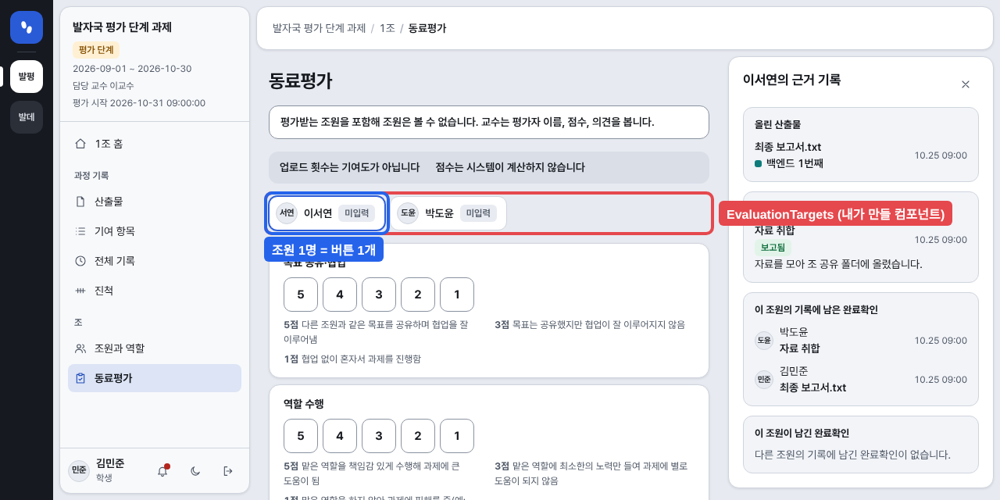

- 빨간 상자: 내가 만들 컴포넌트
- 파란 상자: 조원 1명 = 버튼 1개

점수를 하나 고르면 버튼 글자가 "입력 중"으로 바뀝니다.

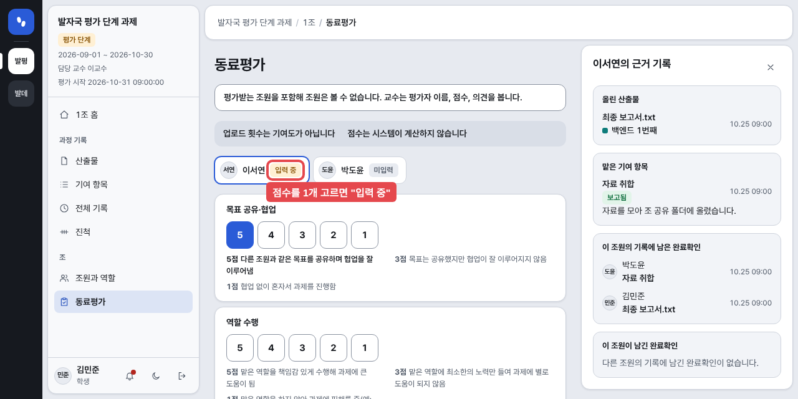

### 내 위치: 어디에서 이어지는가

회색 = 이미 있는 부분 (읽기만), 빨간색 = 내가 만드는 부분

값을 받는 것에 더해, 버튼을 누르면 page에 알리는 일까지 합니다. (6번 화살표)

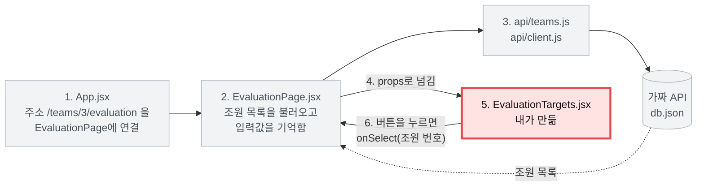

| 단계 | 데모 파일 | 예시 프로젝트에서 같은 역할 | 이번 미션 |
|---|---|---|---|
| 1. 주소를 page에 연결 | `App.jsx` 50번째 줄 | `App.jsx` | 읽기만 |
| 2. 데이터 불러오기 | `pages/EvaluationPage.jsx` 65번째 줄 `getTeamMembers(teamId)` | `pages/AssignmentPage.jsx` 12번째 줄 | 읽기만 |
| 2. 나를 뺀 조원 고르기 | `pages/EvaluationPage.jsx` 56번째 줄 `targets` | 없음 | 읽기만 |
| 2. 입력값 기억하기 | `pages/EvaluationPage.jsx` 31번째 줄 `inputs` | 없음 | 읽기만 |
| 3. 서버에 요청 | `api/teams.js` 9번째 줄 → `api/client.js` | `api/assignments.js` 3번째 줄 | 읽기만 |
| 4. props로 넘기기 | `pages/EvaluationPage.jsx` 225~230번째 줄 | `pages/AssignmentPage.jsx` 26번째 줄 | 읽기만 |
| 5. 화면 그리기 | `components/EvaluationTargets.jsx` | `components/AssignmentList.jsx` | **직접 만듦** |
| 6. 버튼을 누르면 page에 알리기 | `pages/EvaluationPage.jsx` 118번째 줄 `handleSelectTarget` | `pages/AssignmentPage.jsx` 25번째 줄 `onCreated` | 내 컴포넌트에서 부름 |

6번 = 예시 프로젝트의 `AssignmentForm`과 같은 방법. page가 함수를 props로 넘기고, 컴포넌트는 버튼을 누를 때 그 함수를 부릅니다.

데모와 예시 프로젝트의 차이: [안내 2-1](README.md#2-1-할-일)

### 받는 값 (props)

| props | 들어 있는 값 | 예 |
|---|---|---|
| `targets` | 평가할 조원 목록 (배열) | `[{ id: 12, name: "이서연", ... }, ...]` |
| `inputs` | 조원마다 고른 점수 | `{ 12: { goalSharing: 5, ... }, ... }` |
| `selectedId` | 지금 고른 조원의 번호 | `12` |
| `onSelect` | 버튼을 누르면 부르는 page의 함수 | `onSelect(12)` |

※ `goalSharing` 같은 평가 항목 이름 6개는 `frontend/src/constants/peerEvaluation.js`에 있고, 아직 고르지 않은 항목의 값은 `null`입니다.

### 작업 정보

| 항목 | 내용 |
|---|---|
| 만들 파일 | `frontend/src/components/mine/EvaluationTargets.jsx` |
| 원본 | `frontend/src/components/EvaluationTargets.jsx` (31줄) |
| 바꿀 줄 | `frontend/src/pages/EvaluationPage.jsx` 12번째 줄 |
| 계정 | `student01@example.com` (비밀번호 `pass1234`) |
| 주소 | `http://localhost:5173/teams/3/evaluation` |

```
바꾸기 전: import EvaluationTargets from '../components/EvaluationTargets'
바꾼 뒤:   import EvaluationTargets from '../components/mine/EvaluationTargets'
```

**주의:** 화면 아래 [제출] 버튼을 누르면 조원 버튼이 사라지니 누르지 마세요. 이미 눌렀다면 [1차 미션 안내 2-6](../../docs/mission1.md#2-6-처음-상태로-되돌리기)으로 되돌립니다.

### 배우는 것

- [ ] 조원 1명마다 버튼 1개를 그립니다. (`map`, `key`)
  - 찾아볼 것: `React 리스트와 key`
- [ ] 버튼을 누르면 page가 넘겨준 함수(`onSelect`)를 부릅니다.
  - 찾아볼 것: `React props 함수 전달 onClick`
- [ ] 고른 항목의 수를 세어서 "입력함", "입력 중", "미입력"을 정합니다.
  - 찾아볼 것: `JavaScript filter length`

### 성공 확인

- [ ] 조원 버튼 2개(이서연, 박도윤)가 "미입력" 상태로 보입니다.
- [ ] 점수를 하나 고르면 그 조원의 버튼이 "입력 중"으로 바뀝니다.
- [ ] 다른 조원 버튼을 누르면 그 조원이 선택됩니다.

---

## 이종민

**백엔드 / 과제 상세에 조 목록 붙이기 (`GET /assignments/{id}`)**

| `GET /assignments/{id}` | 응답 |
|---|---|
| 지금 | 과제 정보 |
| 이번 미션 뒤 | 과제 정보 + **조 목록** |

2차 미션 조사서에 적은 "과제, 조 테이블을 Entity로 이어서 꺼내는 방법"의 첫 단계입니다.

### 테이블 관계

과제 1개에 조 여러 개가 붙고, 조는 `assignment_id`로 자기 과제를 가리킵니다. (그림에는 이번에 쓰는 열만)

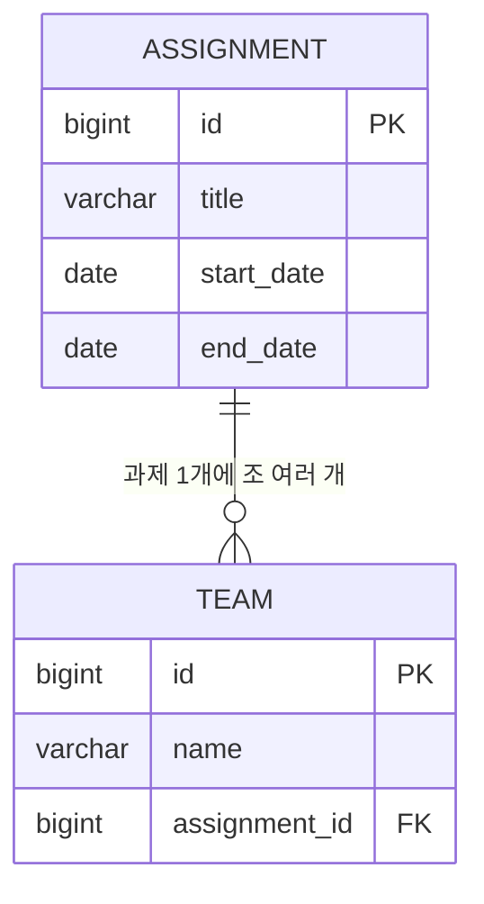

### 요청 흐름

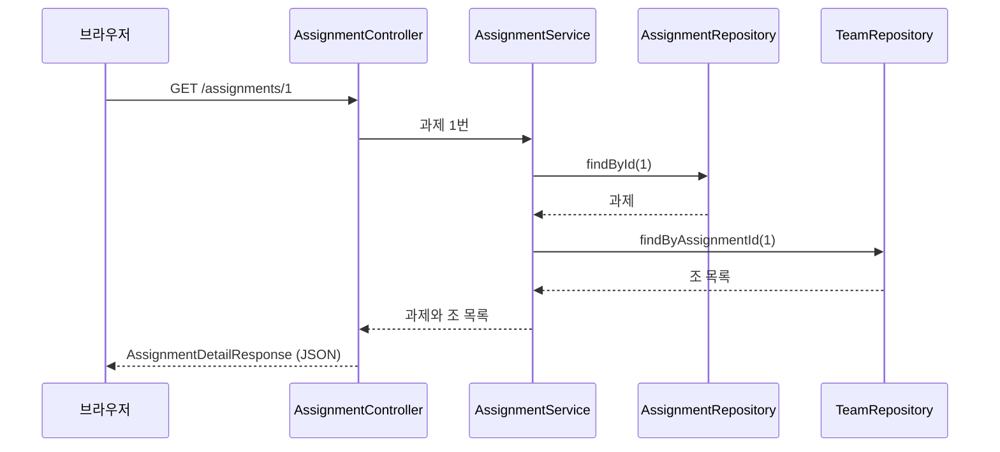

그림은 예시 하나이고, Service 메서드를 나누는 방법은 자유입니다.

### 내 위치: 예시 프로젝트의 어디에 붙이는가

새 파일은 표의 "본보기" 파일을 보면서, 예시 프로젝트의 `Assignment` 파일과 **같은 폴더에 같은 모양으로** 만듭니다.

```
mission3-backend/src/main/java/com/footprint/backend/
├── BackendApplication.java              그대로
├── config/
│   ├── DataInitializer.java             [고침] 조 2개 저장
│   └── WebConfig.java                   그대로
├── controller/
│   └── AssignmentController.java        [고침] 새 응답 모양을 돌려줌
├── dto/
│   ├── AssignmentResponse.java          그대로 (본보기)
│   ├── AssignmentDetailResponse.java    [새로] 과제와 조 목록
│   ├── TeamSummaryResponse.java         [새로] 조 1개
│   └── ...                              그대로
├── entity/
│   ├── Assignment.java                  그대로 (본보기)
│   └── Team.java                        [새로]
├── exception/                           그대로
├── repository/
│   ├── AssignmentRepository.java        그대로 (본보기)
│   └── TeamRepository.java              [새로]
└── service/
    └── AssignmentService.java           [고침] 조 목록 찾기
```

| 파일 | 이번에 | 본보기 | 하는 일 |
|---|---|---|---|
| `entity/Team.java` | 새로 만듦 | `entity/Assignment.java` | 조 테이블과 대응하는 Entity |
| `repository/TeamRepository.java` | 새로 만듦 | `repository/AssignmentRepository.java` | 과제 번호로 조 목록 찾기 |
| `dto/TeamSummaryResponse.java` | 새로 만듦 | `dto/AssignmentResponse.java` | 조 1개의 응답 모양 (`id`, `name`) |
| `dto/AssignmentDetailResponse.java` | 새로 만듦 | `dto/AssignmentResponse.java` | 과제와 조 목록을 함께 담는 응답 모양 (`id`, `title`, `startDate`, `endDate`, `teams`) |
| `config/DataInitializer.java` | 고침 | | 첫 번째 과제에 조 2개 저장 |
| `service/AssignmentService.java` | 고침 | | 조 목록 찾기 |
| `controller/AssignmentController.java` | 고침 | | `GET /assignments/{id}`가 새 응답 모양을 돌려주게 함 |

`Team` Entity의 필드

| 필드 | Java 타입 | 테이블의 열 | 조건 |
|---|---|---|---|
| `id` | `Long` | `id` | 자동으로 늘어나는 번호 |
| `name` | `String` | `name` | 비어 있으면 안 됨 |
| `assignment` | `Assignment` | `assignment_id` | `@ManyToOne`으로 과제와 잇고, 비어 있으면 안 됨 |

힌트

- Entity는 예시 프로젝트의 `entity/Assignment.java`와 같은 방식(`@Entity`, `@Getter`, `@NoArgsConstructor`)으로 만듭니다.
- `assignment` 필드에는 `@Column` 대신 `@JoinColumn(name = "assignment_id", nullable = false)`를 씁니다. `@ManyToOne`과 `@Column`을 같이 쓰면 서버가 뜨지 않습니다.
- `DataInitializer`에서 과제를 저장하면 돌아오는 값을 변수에 담아 두었다가 조를 만들 때 넘기면, 그 과제의 조가 됩니다.
- 조를 저장하려면 `DataInitializer`의 생성자에 `TeamRepository`를 추가합니다.

### 배우는 것

- [ ] `Team`을 과제와 잇습니다. (`@ManyToOne`, `@JoinColumn`)
  - 찾아볼 것: `JPA ManyToOne JoinColumn`
- [ ] 이름만 정하면 Spring이 SQL을 만들어 주는 `findByAssignmentId` 메서드를 `TeamRepository`에 만듭니다.
  - 찾아볼 것: `Spring Data JPA 쿼리 메서드 findBy`
- [ ] 응답 DTO 2개를 예시 프로젝트의 `AssignmentResponse.java`처럼 `record`로 만듭니다.
  - 찾아볼 것: `Java record`

### 성공 확인

| 주소 | 나와야 하는 것 |
|---|---|
| `http://localhost:8080/assignments/1` | `teams`에 1조와 2조 |
| `http://localhost:8080/assignments/3` | `"teams": []` (조가 없는 과제) |
| `http://localhost:8080/assignments/999` | `"code": "NOT_FOUND"` (없는 과제) |

첫 번째 주소의 결과는 이런 모양입니다.

```json
{
  "id": 1,
  "title": "캡스톤 주제 발표",
  "startDate": "2026-10-05",
  "endDate": "2026-10-12",
  "teams": [
    { "id": 1, "name": "1조" },
    { "id": 2, "name": "2조" }
  ]
}
```

### 데모와 다른 점

| | 데모 | 이번 미션 |
|---|---|---|
| 과제 단계, 교수 이름 | 있음 | 뺌 |
| 조장 이름 | 있음 | 뺌 (조원 `team_member`, 회원 `member` 테이블이 필요해서) |

데모의 `AssignmentDetailResponse.java`, `TeamSummaryResponse.java`를 참고해도 됩니다.

---

## 장호진

**백엔드 / 초대 코드로 조 미리보기 (`GET /teams/join/{inviteCode}`)**

학생이 초대 코드를 열면 "어느 과제의 어느 조인지"를 먼저 보여 주는 API로, 2차 미션 조사서에 적은 "없는 초대 코드를 입력했을 때"도 직접 막습니다.

### 테이블 관계

과제 1개에 조 여러 개가 붙고, 초대 코드는 조마다 하나씩이라 다른 조와 겹치면 안 됩니다. (그림에는 이번에 쓰는 열만)

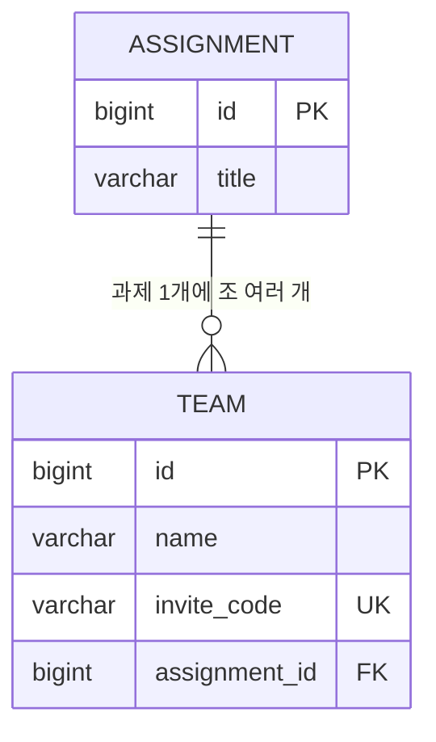

### 요청 흐름

맞는 조가 있을 때와 없을 때, 흐름이 둘로 갈라집니다.

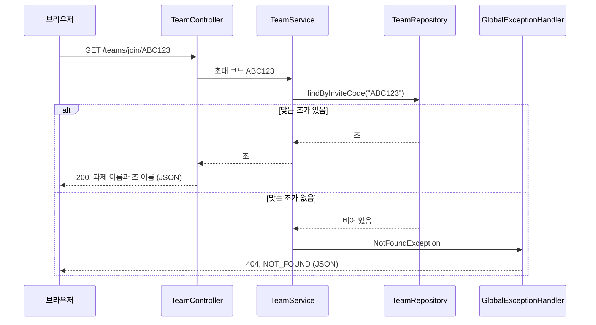

### 내 위치: 예시 프로젝트의 어디에 붙이는가

새 파일은 표의 "본보기" 파일을 보면서, 예시 프로젝트의 `Assignment` 파일과 **같은 폴더에 같은 모양으로** 만듭니다.

```
mission3-backend/src/main/java/com/footprint/backend/
├── BackendApplication.java              그대로
├── config/
│   ├── DataInitializer.java             [고침] 조 2개 저장
│   └── WebConfig.java                   그대로
├── controller/
│   ├── AssignmentController.java        그대로 (본보기)
│   └── TeamController.java              [새로]
├── dto/
│   ├── AssignmentResponse.java          그대로 (본보기)
│   ├── TeamJoinPreviewResponse.java     [새로]
│   └── ...                              그대로
├── entity/
│   ├── Assignment.java                  그대로 (본보기)
│   └── Team.java                        [새로]
├── exception/
│   ├── GlobalExceptionHandler.java      그대로 (404 응답을 만듦)
│   └── NotFoundException.java           그대로 (조가 없을 때 던짐)
├── repository/
│   ├── AssignmentRepository.java        그대로 (본보기)
│   └── TeamRepository.java              [새로]
└── service/
    ├── AssignmentService.java           그대로 (본보기)
    └── TeamService.java                 [새로]
```

| 파일 | 이번에 | 본보기 | 하는 일 |
|---|---|---|---|
| `entity/Team.java` | 새로 만듦 | `entity/Assignment.java` | 조 테이블과 대응하는 Entity |
| `repository/TeamRepository.java` | 새로 만듦 | `repository/AssignmentRepository.java` | 초대 코드로 조 1개 찾기 |
| `dto/TeamJoinPreviewResponse.java` | 새로 만듦 | `dto/AssignmentResponse.java` | 응답 모양 (`assignmentTitle`, `teamName`) |
| `service/TeamService.java` | 새로 만듦 | `service/AssignmentService.java` | 조를 찾고, 없으면 `NotFoundException` |
| `controller/TeamController.java` | 새로 만듦 | `controller/AssignmentController.java` | `GET /teams/join/{inviteCode}` 주소를 받음 |
| `config/DataInitializer.java` | 고침 | | 첫 번째 과제에 조 2개 저장 |

`Team` Entity의 필드

| 필드 | Java 타입 | 테이블의 열 | 조건 |
|---|---|---|---|
| `id` | `Long` | `id` | 자동으로 늘어나는 번호 |
| `name` | `String` | `name` | 비어 있으면 안 됨 |
| `inviteCode` | `String` | `invite_code` | 다른 조와 겹치면 안 됨 |
| `assignment` | `Assignment` | `assignment_id` | `@ManyToOne`으로 과제와 잇고, 비어 있으면 안 됨 |

시작 데이터: 첫 번째 과제에 "1조"(초대 코드 `ABC123`)와 "2조"(초대 코드 `XYZ789`)를 저장합니다.

힌트

- Entity는 예시 프로젝트의 `entity/Assignment.java`와 같은 방식(`@Entity`, `@Getter`, `@NoArgsConstructor`)으로 만듭니다.
- `assignment` 필드에는 `@Column` 대신 `@JoinColumn(name = "assignment_id", nullable = false)`를 씁니다. `@ManyToOne`과 `@Column`을 같이 쓰면 서버가 뜨지 않습니다.
- `DataInitializer`에서 과제를 저장하면 돌아오는 값을 변수에 담아 두었다가 조를 만들 때 넘기면, 그 과제의 조가 됩니다.
- 조를 저장하려면 `DataInitializer`의 생성자에 `TeamRepository`를 추가합니다.

### 배우는 것

- [ ] `Team`을 과제와 잇고, 초대 코드가 겹치지 않게 합니다. (`@ManyToOne`, `@Column(unique = true)`)
  - 찾아볼 것: `JPA ManyToOne JoinColumn`, `JPA Column unique`
- [ ] `Optional<Team>`을 돌려주는 `findByInviteCode` 메서드를 `TeamRepository`에 만듭니다.
  - 찾아볼 것: `Spring Data JPA Optional findBy`
- [ ] 예시 프로젝트 `AssignmentService`의 `findById`처럼 `orElseThrow`를 써서, 조가 없으면 `NotFoundException`을 던집니다.
  - 찾아볼 것: `Java Optional orElseThrow`
- [ ] Controller와 Service를 예시 프로젝트의 `AssignmentController`, `AssignmentService`와 같은 모양으로 새로 만듭니다.

### 성공 확인

| 주소 | 나와야 하는 것 |
|---|---|
| `http://localhost:8080/teams/join/ABC123` | `{"assignmentTitle":"캡스톤 주제 발표","teamName":"1조"}` |
| `http://localhost:8080/teams/join/XYZ789` | `teamName`이 `"2조"` |
| `http://localhost:8080/teams/join/WRONG1` | `"code": "NOT_FOUND"` (없는 코드) |

### 데모와 다른 점

| | 데모 | 이번 미션 |
|---|---|---|
| 조장 이름 | 돌려줌 | 뺌 |
| 합류할 수 있는 사람인지 검사 (교수인지, 이미 다른 조에 있는지) | 함 | 뺌 |

### (선택) 추가 실험

2조의 초대 코드를 `ABC123`으로 바꾸고 서버를 실행해서, 내 `data_model.md`에 적은 `invite_code`의 UNIQUE 위반(`Unique index or primary key violation`)을 직접 보고 캡처합니다. `Started BackendApplication`이 먼저 찍힌 뒤에 오류가 나고 서버가 꺼지니, 로그를 끝까지 봅니다.
