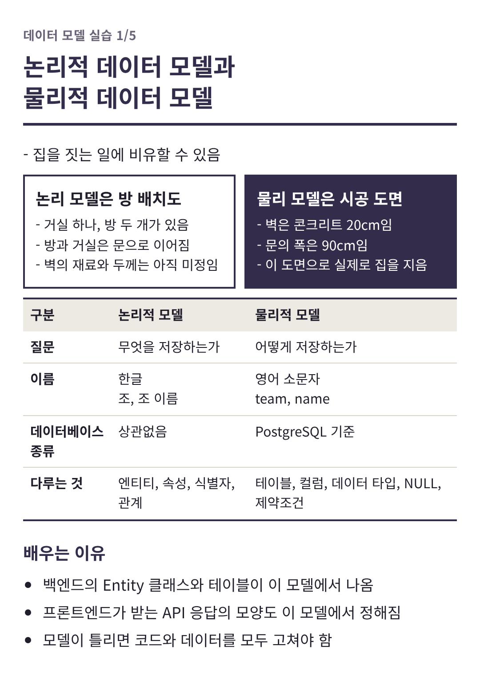
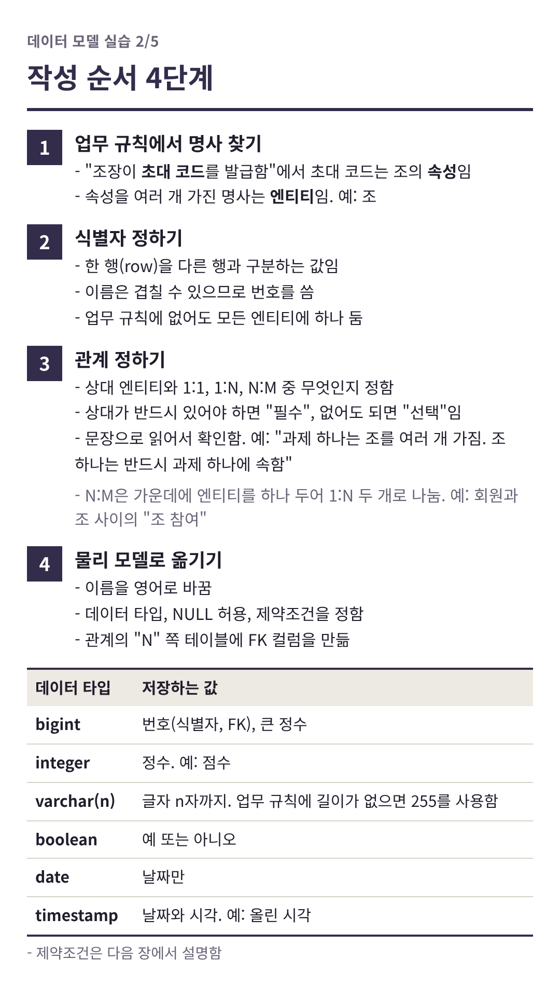
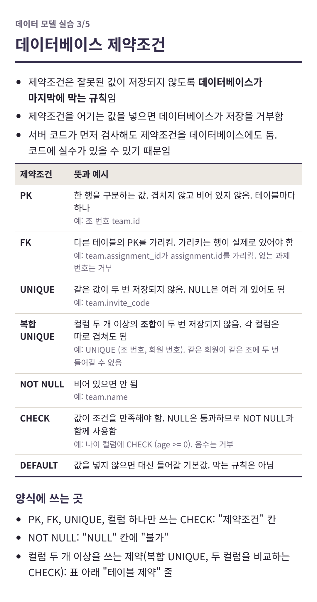
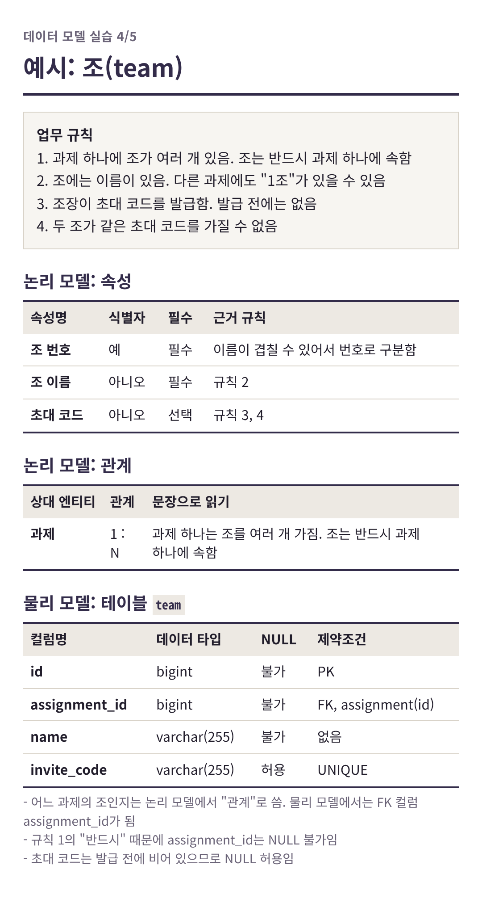
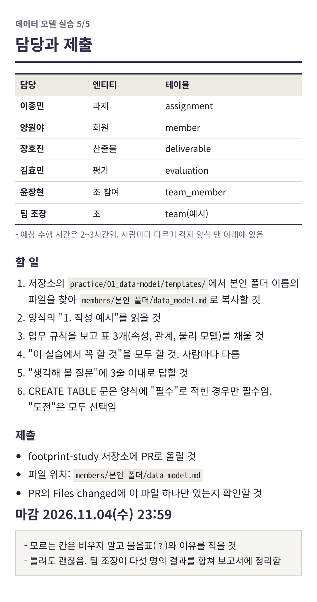

# 데이터 모델 실습

- 이번 주 실습: 발자국의 데이터 모델 직접 작성
- 한 사람이 엔티티 하나를 맡아 논리적 데이터 모델과 물리적 데이터 모델을 작성함
- 결과는 보고서의 "데이터 모델" 부분에 들어감
- 마감: 2026.11.04(수) 23:59
- 예상 수행 시간은 2~3시간임. 각자 양식 맨 아래에 있음

## 담당

| 담당 | 엔티티 | 테이블 | 양식 |
|---|---|---|---|
| 이종민 | 과제 | assignment | [templates/jongmin.md](templates/jongmin.md) |
| 양원야 | 회원 | member | [templates/yangwenya.md](templates/yangwenya.md) |
| 장호진 | 산출물 | deliverable | [templates/hojinjang.md](templates/hojinjang.md) |
| 김효민 | 평가 | evaluation | [templates/hyomin.md](templates/hyomin.md) |
| 윤장현 | 조 참여 | team_member | [templates/yoon.md](templates/yoon.md) |
| 팀 조장 | 조 | team | 각 양식의 "1. 작성 예시" |

## 하는 방법

1. 아래 설명 이미지 5장을 순서대로 읽을 것
2. `templates/`에서 본인 폴더 이름의 파일을 `members/본인 폴더/data_model.md`로 복사할 것
   - 예: 이종민은 `templates/jongmin.md`를 `members/jongmin/data_model.md`로 복사함
   - 복사하기 전에 main을 최신으로 받을 것(`git pull`)
   - GitHub 웹에서 작업하면 양식 파일의 Raw 버튼으로 내용을 복사한 뒤, 본인 폴더에서 Add file → Create new file로 `data_model.md`를 만들 것
3. 양식의 "1. 작성 예시"를 보고 본인 엔티티의 표를 채울 것
   - "이 실습에서 꼭 할 것"은 사람마다 다름. 반드시 확인할 것
4. PR로 올릴 것
   - PR에는 `members/본인 폴더/data_model.md` 하나만 올라가야 함
   - `practice/` 폴더의 파일은 고치지 말 것

- 모르는 칸은 비우지 말고 물음표(`?`)와 이유를 적을 것
- 질문은 단체방에 올릴 것

## 설명 이미지

