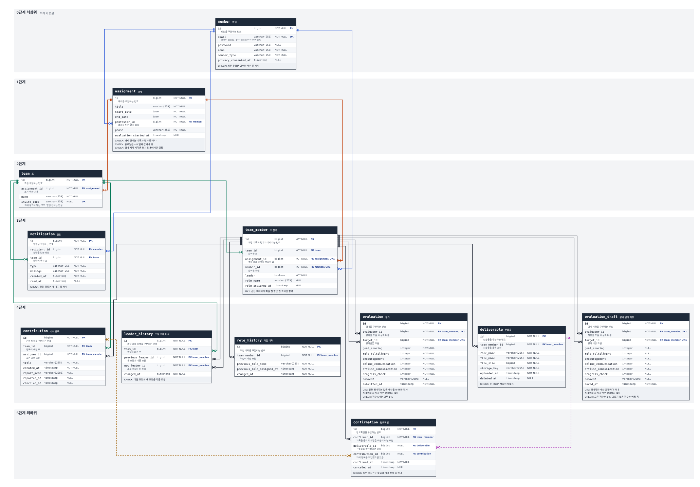
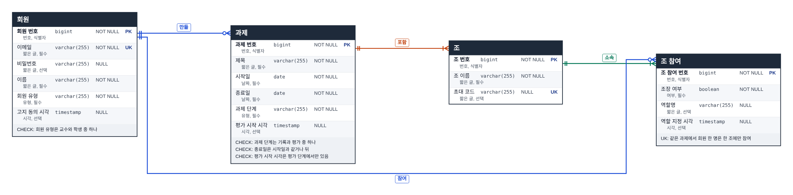
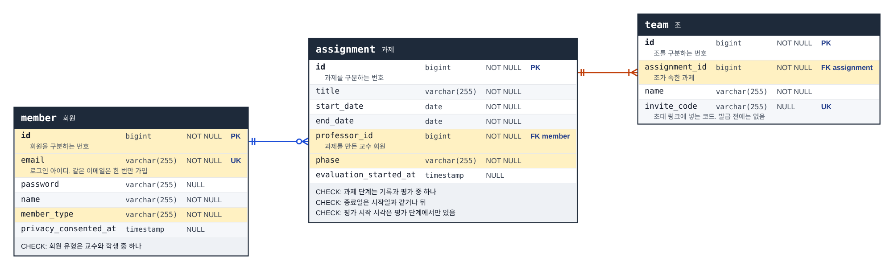
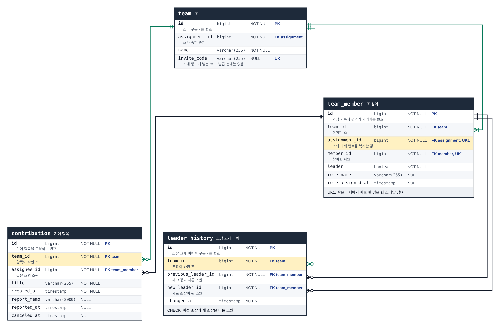
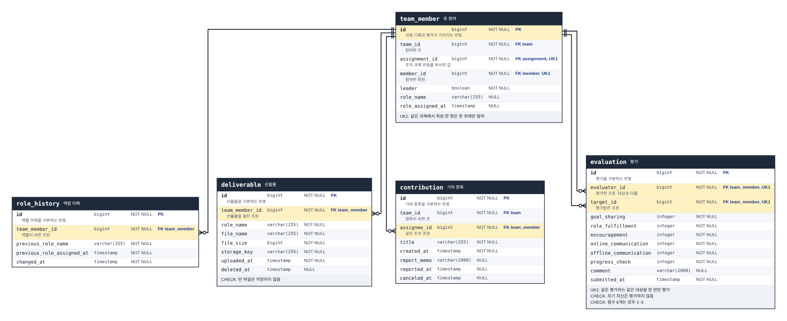
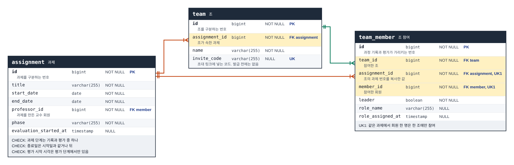
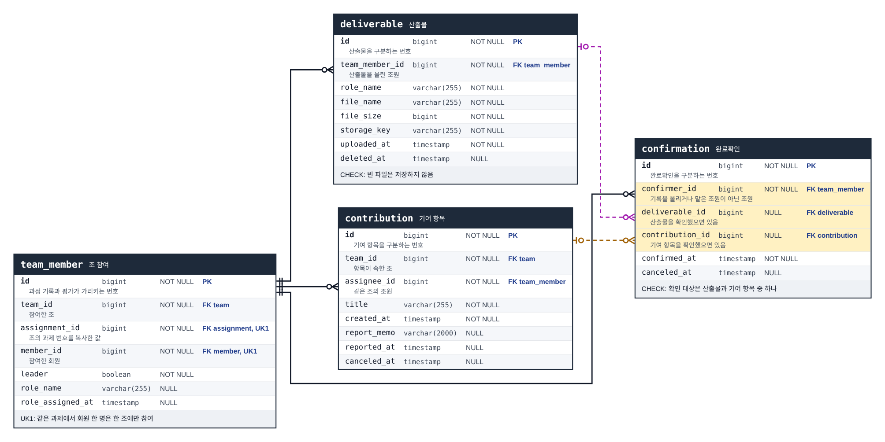
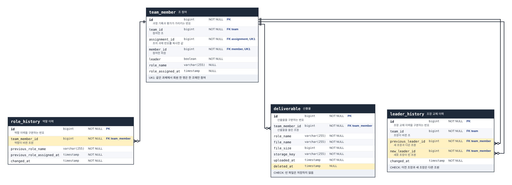
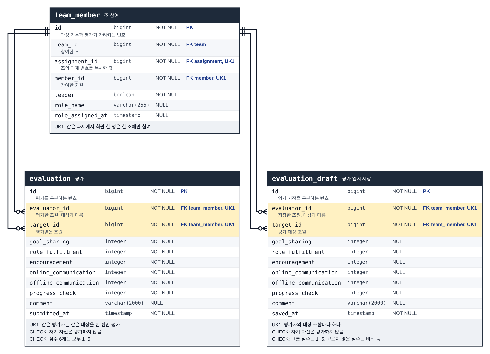
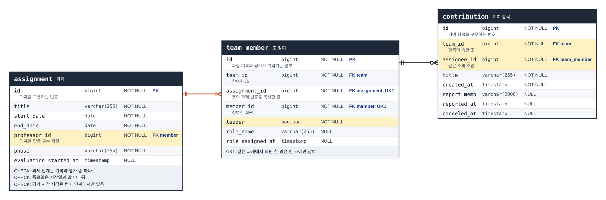

# ERD 발표 순서

> 기준 문서: ERD 캔버스(erd_canvas.html), 데이터 모델 v4
> 발표: 2026.11.12(목) 14시, 캡스톤디자인 3조
> 대상: 테이블 12개, 외래 키 21개
> 구성: 발표 방식, 단계별 담당, 10단계 설명

## 가. 발표 방식

1) ERD 캔버스의 "발표 순서" 버튼으로 10단계를 차례로 띄움. 1단계는 전체 그림, 나머지 단계는 관련 테이블만 따로 배치한 그림을 보여 줌
2) 2단계는 논리 모델 화면이고, 나머지 단계는 물리 모델 화면임
3) 그림의 노란 칸은 그 단계에서 짚는 컬럼임
4) 테이블을 맡은 조원이 그 단계를 설명하고, 맡은 테이블에 대한 질문에 답함
5) 팀 조장은 발표 진행을 맡고, 담당자가 답하지 못한 질문에 대신 답함

[표 1] 단계별 담당

| 단계 | 주제 | 발표 | 화면 |
|---|---|---|---|
| 1단계 | 전체 구조 | 이종민 | 물리 모델 |
| 2단계 | 논리 모델: 조 구성 | 이종민 | 논리 모델 |
| 3단계 | 논리 모델에서 물리 모델로 | 양원야 | 물리 모델 |
| 4단계 | 정규화 | 장호진 | 물리 모델 |
| 5단계 | 설계 판단 1. 조 참여가 중심 | 윤장현 | 물리 모델 |
| 6단계 | 설계 판단 2. 과제 번호 복사와 묶음 UNIQUE | 윤장현 | 물리 모델 |
| 7단계 | 설계 판단 3. 완료확인의 두 대상 | 장호진 | 물리 모델 |
| 8단계 | 설계 판단 4. 지우지 않고 쌓음 | 김효민 | 물리 모델 |
| 9단계 | 동료평가 | 김효민 | 물리 모델 |
| 10단계 | 데이터베이스 제약으로 두지 않은 규칙 | 윤장현 | 물리 모델 |

## 나. 단계별 설명

### 1단계. 전체 구조

발표 이종민 / 물리 모델 / 테이블 전체

1) 테이블은 12개, 테이블을 잇는 외래 키는 21개. 위에서 아래로 6단계
2) 위에 있는 테이블일수록 다른 테이블을 가리키지 않음. 맨 위는 `member`
3) 맨 아래는 `confirmation`. 산출물이나 기여 항목을 확인한 기록
4) 선은 외래 키 컬럼에서 나와, 가리키는 테이블의 `id`로 들어감. 선 색은 가리키는 테이블마다 다름

### 2단계. 논리 모델: 조 구성

발표 이종민 / 논리 모델 / 테이블 `member`, `assignment`, `team`, `team_member`

1) 논리 모델은 무엇을 저장할지 정한 그림. 외래 키 컬럼 대신 관계선으로 연결함
2) 교수가 과제를 만듦. 과제에는 조가 있고, 조에는 조원이 있음
3) 회원 한 명은 여러 조에 들어가고, 조 하나에는 여러 회원이 들어감. 이 관계를 조 참여로 풀었음
4) 과제에 조가 하나 이상 있어야 한다는 규칙은 외래 키로 막을 수 없음. 과제를 만들 때 조와 조장을 함께 저장해서 지킴

### 3단계. 논리 모델에서 물리 모델로

발표 양원야 / 물리 모델 / 테이블 `member`, `assignment`, `team`

1) 엔티티 12개가 테이블 12개가 됨. 교수와 학생은 저장하는 값이 같아서 `member` 하나에 넣고 회원 유형으로 구분함
2) 모든 테이블의 기본 키는 자동으로 붙는 번호 `id`. 이메일은 겹치지 않게 UNIQUE만 걸었음
3) 관계 20개가 외래 키 21개가 됨. 하나 늘어난 것은 일부러 복사한 `team_member.assignment_id`
4) 정해진 값만 들어가는 컬럼(회원 유형, 과제 단계, 알림 종류)은 CHECK로 다른 값을 막음

※ 노란 칸: `member.id`, `member.member_type`, `member.email`, `assignment.professor_id`, `assignment.phase`, `team.assignment_id`

### 4단계. 정규화

발표 장호진 / 물리 모델 / 테이블 `team`, `team_member`, `contribution`, `leader_history`

1) 제1정규형: 칸 하나에 값 하나만 넣음. 점수 6개는 뜻이 서로 다른 항목이라 컬럼 6개로 둠
2) 제2정규형: 기본 키가 모두 `id` 하나라서, 키의 일부에만 딸린 컬럼이 없음
3) 제3정규형: 다른 테이블에서 알 수 있는 값은 다시 저장하지 않음. 노란 칸 3곳만 이유가 있어 다시 저장함
4) 산출물의 역할명은 올릴 때의 역할을 남긴 기록이라, 같은 값을 다시 저장한 것이 아님

※ 노란 칸: `team_member.assignment_id`, `contribution.team_id`, `leader_history.team_id`

### 5단계. 설계 판단 1. 조 참여가 중심

발표 윤장현 / 물리 모델 / 테이블 `team_member`, `role_history`, `deliverable`, `contribution`, `evaluation`

1) 산출물, 기여 항목, 완료확인, 평가, 이력은 회원이 아니라 조 참여를 가리킴
2) 같은 회원도 과제마다 다른 조에서 다른 역할을 맡기 때문
3) 학생의 요청은 그 조의 조원인지를 조 참여로 검사함. 교수의 요청은 그 과제를 만든 교수인지로 검사함
4) 조장도 테이블을 따로 두지 않고 조 참여의 `leader` 컬럼으로 표시함

※ 노란 칸: `team_member.id`, `role_history.team_member_id`, `deliverable.team_member_id`, `contribution.assignee_id`, `evaluation.evaluator_id`, `evaluation.target_id`

### 6단계. 설계 판단 2. 과제 번호 복사와 묶음 UNIQUE

발표 윤장현 / 물리 모델 / 테이블 `assignment`, `team`, `team_member`

1) 규칙: 같은 과제에서 회원 한 명은 한 조에만 참여함
2) UNIQUE는 한 테이블 안의 컬럼만 묶을 수 있음. 그래서 조의 과제 번호를 조 참여에 복사함
3) `UNIQUE(assignment_id, member_id)`: 같은 과제와 같은 회원의 조합은 한 번만 저장됨
4) 복사한 값은 조 참여를 만들 때 한 번만 넣고 바꾸지 않음

※ 노란 칸: `team.assignment_id`, `team_member.assignment_id`, `team_member.member_id`, `team_member.team_id`

### 7단계. 설계 판단 3. 완료확인의 두 대상

발표 장호진 / 물리 모델 / 테이블 `team_member`, `deliverable`, `contribution`, `confirmation`

1) 완료확인의 대상은 산출물 또는 기여 항목
2) 대상 번호 컬럼을 하나만 두면 어느 테이블의 번호인지 알 수 없어서 외래 키를 걸 수 없음
3) 그래서 외래 키를 두 개 두고, CHECK로 둘 중 하나만 값이 있게 함. 점선이 이 관계임
4) 자기 기록은 확인할 수 없고, 기여 항목은 완료 보고 뒤에만 확인함. 이 규칙은 서버가 검사함

※ 노란 칸: `confirmation.deliverable_id`, `confirmation.contribution_id`, `confirmation.confirmer_id`

### 8단계. 설계 판단 4. 지우지 않고 쌓음

발표 김효민 / 물리 모델 / 테이블 `team_member`, `role_history`, `leader_history`, `deliverable`

1) 역할이나 조장이 바뀌면 이전 값을 이력 테이블에 한 행씩 쌓음
2) 산출물 삭제, 기여 항목 취소, 완료확인 취소는 행을 지우지 않고 시각만 남김
3) 다른 행이 가리키고 있는 행은 데이터베이스가 지우지 못하게 막음
4) 실제로 지우는 것은 평가 임시 저장뿐. 이 테이블을 가리키는 테이블은 없음

※ 노란 칸: `role_history.team_member_id`, `leader_history.previous_leader_id`, `leader_history.new_leader_id`, `deliverable.deleted_at`

### 9단계. 동료평가

발표 김효민 / 물리 모델 / 테이블 `team_member`, `evaluation`, `evaluation_draft`

1) 평가한 조원과 평가받은 조원이 모두 조 참여를 가리킴
2) `UNIQUE(evaluator_id, target_id)`: 같은 조원을 두 번 평가할 수 없음
3) CHECK로 자기 자신 평가를 막고, 점수 6개는 1~5만 받음
4) 임시 저장은 고른 점수만 저장하고, 제출하면 지움. 점수와 의견은 교수만 봄

※ 노란 칸: `evaluation.evaluator_id`, `evaluation.target_id`, `evaluation_draft.evaluator_id`, `evaluation_draft.target_id`

### 10단계. 데이터베이스 제약으로 두지 않은 규칙

발표 윤장현 / 물리 모델 / 테이블 `assignment`, `team_member`, `contribution`

1) 조마다 조장은 한 명: 조장을 바꿀 때 두 조원의 값을 차례로 바꾸므로, 서버가 그 조를 잠그고 처리함
2) 교수만 과제를 만듦: CHECK는 같은 테이블의 값만 볼 수 있어서, 서버가 회원 유형을 검사함
3) 담당 조원은 같은 조의 조원: 데이터베이스로 막으면 구조가 복잡해져서 서버가 검사함
4) 조원끼리 평가를 볼 수 없음: 누가 볼 수 있는지는 데이터베이스 제약으로 정할 수 없어서 서버가 검사함

※ 노란 칸: `team_member.leader`, `assignment.professor_id`, `contribution.assignee_id`, `contribution.team_id`
