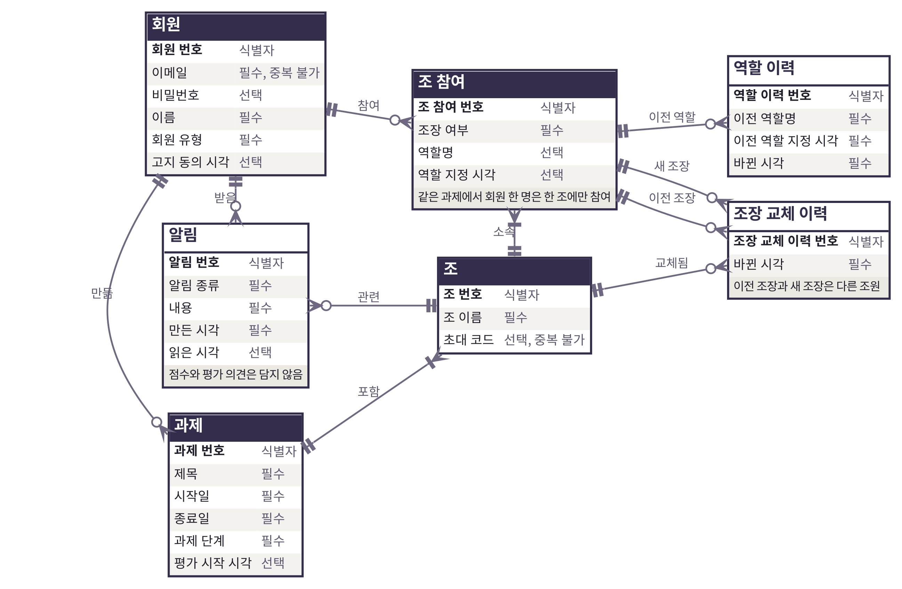
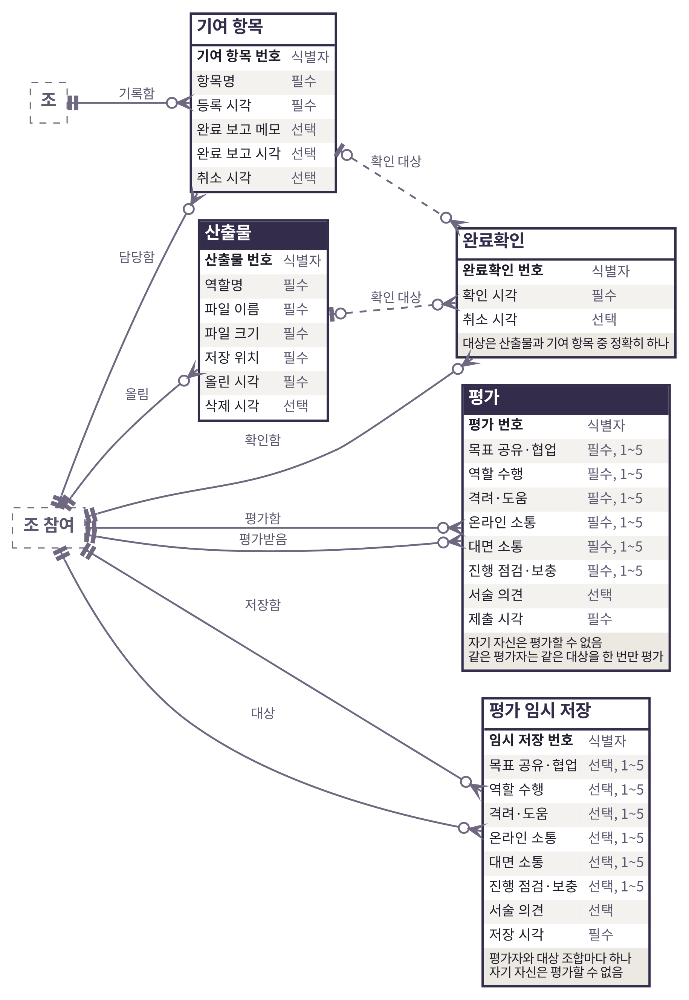
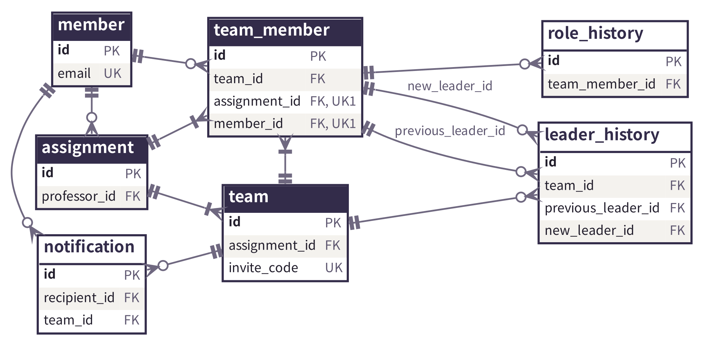
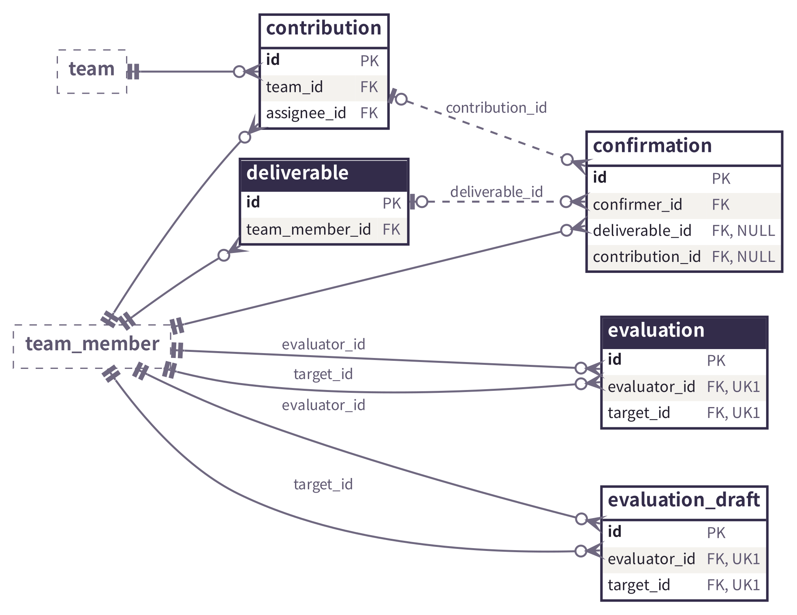

# 데이터 모델

## 가. 데이터 모델 개요

1) 발자국의 데이터는 엔티티 12개로 구성되며, 조 참여를 기준으로 과정 기록과 동료평가를 연결함
2) 같은 회원이라도 조마다 역할이 다르므로 산출물, 기여 항목, 완료확인, 평가는 회원이 아니라 조 참여를 가리킴
3) 기록 시각은 모두 서버가 남기고, 과정 기록은 지우지 않고 삭제 시각과 취소 시각을 함께 남김
4) 평가 임시 저장은 동료평가를 제출할 때 지우며, 과정 기록이 아니므로 남기지 않음
5) 데이터 표준, 논리적 데이터 모델, 물리적 데이터 모델의 순서로 작성하며, 모든 정의서는 같은 이름과 도메인을 씀

※ 용어: ERD(개체 관계도, 엔티티와 관계를 그린 그림), 엔티티(관리할 대상), 속성(엔티티가 가진 값), 식별자(엔티티 하나를 구분하는 속성), 도메인(속성이 가질 수 있는 값의 종류와 범위), PK(기본 키, 행을 구분하는 값), FK(외래 키, 다른 테이블의 기본 키를 가리키는 값), UNIQUE(같은 값의 중복을 막는 제약), CHECK(값이 조건을 만족해야 저장되는 제약), NULL(값이 비어 있음), 인덱스(값을 빨리 찾기 위해 데이터베이스가 따로 정리한 목록), 잠금(같은 행을 여러 요청이 동시에 바꾸지 못하게 하는 처리), 비식별 관계(부모의 기본 키가 자식의 기본 키에 들어가지 않는 관계), 반정규화(이유가 있어 같은 값을 두 곳에 저장하는 것)

[표 1] 데이터 모델 산출물 구성

| 구분 | 산출물 | 내용 |
|---|---|---|
| 데이터 표준 | 용어 사전 | 엔티티, 속성, 컬럼 이름에 쓰는 단어 |
| 데이터 표준 | 도메인 정의서 | 속성이 가질 수 있는 값의 종류와 범위 |
| 데이터 표준 | 코드 정의서 | 정해진 값 중 하나만 갖는 속성의 값 |
| 논리적 데이터 모델 | 논리 ERD | 엔티티, 속성, 관계를 그린 그림 |
| 논리적 데이터 모델 | 엔티티 정의서 | 엔티티의 뜻, 식별자, 부모 엔티티 |
| 논리적 데이터 모델 | 속성 정의서 | 엔티티별 속성, 도메인, 필수 여부 |
| 논리적 데이터 모델 | 관계 정의서 | 엔티티 사이의 관계와 대응 관계 |
| 물리적 데이터 모델 | 물리 ERD | 테이블과 키 컬럼을 그린 그림 |
| 물리적 데이터 모델 | 테이블 정의서 | 테이블 목록과 도입 시점 |
| 물리적 데이터 모델 | 컬럼 정의서 | 테이블별 컬럼, 데이터 타입, 제약 |
| 물리적 데이터 모델 | 제약 정의서 | 외래 키, UNIQUE, CHECK 제약 |
| 물리적 데이터 모델 | 인덱스 정의서 | 데이터베이스가 만드는 인덱스 |

## 나. 개요서 초안 대비 변경

[표 2] 개요서 초안 대비 변경

| 구분 | 개요서 | 현행 | 근거 |
|---|---|---|---|
| 엔티티 수 | 8개 | 12개 | 역할 이력, 조장 교체 이력, 평가 임시 저장, 알림 추가 |
| 조장 표시 | 조가 조장 회원을 가리킴 | 조 참여의 조장 여부 | 조장도 조원으로 함께 기록하기 위함 |
| 완료확인 대상 | 대상 종류와 대상 번호 | 대상별 외래 키 두 개 | 대상마다 외래 키 제약을 걸기 위함 |
| 조 참여 중복 기준 | 조와 회원 | 과제와 회원 | 같은 과제의 다른 조 참여를 막기 위함 |
| 과제 상태 | 상태 | 과제 단계와 평가 시작 시각 | 기록 단계와 평가 단계를 나누기 위함 |
| 평가 점수 컬럼 | s1~s6 | 항목별 이름 | 컬럼 이름만으로 항목을 알 수 있게 함 |
| 평가의 조 | 평가가 조를 가리킴 | 없음 | 평가자의 조 참여로 조를 알 수 있음 |
| 회원 고지 동의 | 없음 | 고지 동의 시각 | 개인정보 고지에 동의한 시각을 남기기 위함 |
| 빠진 속성 | 산출물 버전, 기여 항목 등록자 | 없음 | 올린 시각과 조장 교체 이력으로 알 수 있음 |

## 다. 데이터 표준

1) 엔티티와 속성은 한글 이름, 테이블과 컬럼은 영어 소문자와 밑줄로 지음
2) 컬럼 이름은 용어 사전의 단어를 밑줄로 이어 만듦. 식별자는 id로 하고, 시각 컬럼은 _at으로 끝냄
3) 다른 테이블을 가리키는 컬럼은 가리키는 대상의 뜻을 붙여 짓고 _id로 끝냄. 예: 과제를 만든 교수는 professor_id

[표 3] 용어 사전

| 용어 | 물리 이름 | 뜻 |
|---|---|---|
| 회원 | member | 서비스에 로그인하는 교수와 학생 |
| 교수 | professor | 과제를 만들고 결과를 열람하는 회원 |
| 과제 | assignment | 교수가 수업에서 낸 조별과제 |
| 조 | team | 과제 아래에서 함께 작업하는 학생 묶음 |
| 조 참여 | team_member | 회원 한 명이 조 하나에 속한 것. 조원과 같은 뜻 |
| 조장 | leader | 조원을 초대하고 역할을 정하는 조원 |
| 역할 | role | 조장이 조원에게 정한 일의 이름 |
| 이력 | history | 바뀌기 전 값을 쌓은 기록 |
| 산출물 | deliverable | 조원이 올린 결과 파일 |
| 기여 항목 | contribution | 회의 진행처럼 파일로 남지 않는 기여 |
| 완료확인 | confirmation | 다른 조원이 기록을 보고 완료를 확인한 것 |
| 평가 | evaluation | 조원이 다른 조원에게 매긴 동료평가 |
| 임시 저장 | draft | 제출 전에 저장한 입력값 |
| 알림 | notification | 회원에게 보여 주는 안내 |
| 번호 | id | 행을 구분하는 값 |
| 시각 | at | 날짜와 시각. 서버가 기록 |
| 날짜 | date | 연월일 |
| 이름 | name | 화면에 보이는 이름 |
| 제목 | title | 과제 또는 기여 항목의 제목 |
| 이메일 | email | 로그인 아이디 |
| 비밀번호 | password | 해시로 바꿔 저장한 비밀번호 |
| 유형 | type | 정해진 값 중 하나 |
| 단계 | phase | 과제의 진행 단계 |
| 시작 | start, started | 기간이나 단계가 시작됨 |
| 종료 | end | 기간이 끝남 |
| 개인정보 고지 동의 | privacy, consented | 개인정보 처리 고지에 동의함 |
| 초대 코드 | invite, code | 조에 합류하는 링크에 넣는 값 |
| 지정 | assigned | 역할이나 담당을 정함 |
| 담당 | assignee | 기여 항목을 맡은 조원 |
| 이전 | previous | 바뀌기 전 |
| 새 | new | 바뀐 뒤 |
| 바뀜 | changed | 값이 바뀜 |
| 파일 | file | 산출물의 본문 |
| 크기 | size | 바이트 수 |
| 저장 위치 | storage, key | 파일 저장소 안에서 파일을 찾는 값 |
| 올림 | uploaded | 파일을 올림 |
| 삭제 | deleted | 지운 것으로 표시함 |
| 만듦 | created | 행을 처음 만듦 |
| 보고 | report, reported | 담당 조원이 완료를 알림 |
| 메모 | memo | 짧은 설명 글 |
| 취소 | canceled | 되돌림. 행은 남김 |
| 확인 | confirmer, confirmed | 완료확인을 한 사람, 한 시각 |
| 평가자 | evaluator | 평가를 입력하는 조원 |
| 대상 | target | 평가를 받는 조원 |
| 서술 의견 | comment | 점수와 함께 적는 글 |
| 제출 | submitted | 평가를 냄 |
| 저장 | saved | 임시 저장함 |
| 받는 회원 | recipient | 알림을 받는 회원 |
| 내용 | message | 알림 문장 |
| 읽음 | read | 알림을 읽음 |
| 목표 공유·협업 | goal_sharing | 동료평가 점수 항목 |
| 역할 수행 | role_fulfillment | 동료평가 점수 항목 |
| 격려·도움 | encouragement | 동료평가 점수 항목 |
| 온라인 소통 | online_communication | 동료평가 점수 항목 |
| 대면 소통 | offline_communication | 동료평가 점수 항목 |
| 진행 점검·보충 | progress_check | 동료평가 점수 항목 |

[표 4] 도메인 정의서

| 도메인 | 데이터 타입 | 허용 값 | 적용 속성 |
|---|---|---|---|
| 번호 | bigint | 자동으로 붙는 1 이상의 정수 | 모든 식별자, 외래 키 |
| 짧은 글 | varchar(255) | 255자 이내 글자 | 이름, 제목, 이메일, 역할명, 코드, 저장 위치 |
| 긴 글 | varchar(2000) | 2000자 이내 글자 | 서술 의견, 완료 보고 메모 |
| 날짜 | date | 연월일 | 과제 시작일, 종료일 |
| 시각 | timestamp | 서버가 기록한 날짜와 시각 | 모든 기록 시각 |
| 여부 | boolean | 참 또는 거짓 | 조장 여부 |
| 점수 | integer | 1 이상 5 이하의 정수 | 동료평가 항목 6개 |
| 크기 | bigint | 1 이상의 바이트 수 | 파일 크기 |
| 유형 | varchar(255) | 정해진 이름 중 하나 | 회원 유형, 과제 단계, 알림 종류 |

[표 5] 코드 정의서

| 테이블 | 컬럼 | 값 | 뜻 |
|---|---|---|---|
| member | member_type | PROFESSOR | 교수 |
| member | member_type | STUDENT | 학생 |
| assignment | phase | RECORDING | 기록 단계. 과정 기록을 남김 |
| assignment | phase | EVALUATION | 평가 단계. 과정 기록을 바꾸지 않고 동료평가를 받음 |
| notification | type | EVALUATION_STARTED | 과제가 평가 단계로 바뀜 |
| notification | type | CONTRIBUTION_ASSIGNED | 기여 항목의 담당 조원으로 지정됨 |
| notification | type | CONTRIBUTION_REPORTED | 맡긴 기여 항목의 완료 보고가 들어옴 |

※ 코드 값은 순서 번호가 아니라 영어 이름 글자로 저장함. 값의 순서를 바꾸어도 저장된 값의 뜻이 바뀌지 않음

## 라. 논리적 데이터 모델

[그림 1] 논리 ERD: 조 구성과 알림(가로 쪽)

[그림 2] 논리 ERD: 과정 기록과 동료평가

※ 선 끝 표시: 두 줄은 반드시 하나, 원과 한 줄은 없거나 하나, 까마귀발과 한 줄은 하나 이상, 까마귀발과 원은 없거나 여러 개. 점선 관계는 완료확인이 산출물과 기여 항목 중 하나만 가리킴을 뜻함. 머리를 채운 엔티티는 2026.12.11 학기 발표 흐름에 쓰는 엔티티이고, 점선 상자는 다른 그림에 있는 엔티티임. 모든 관계는 비식별 관계임

[표 6] 엔티티 정의서

| 엔티티 | 설명 | 식별자 | 부모 엔티티 |
|---|---|---|---|
| 회원 | 서비스에 로그인하는 교수와 학생 | 회원 번호 | 없음 |
| 과제 | 교수가 만든 조별과제와 진행 단계 | 과제 번호 | 회원 |
| 조 | 과제에 속한 조와 초대 코드 | 조 번호 | 과제 |
| 조 참여 | 어느 회원이 어느 조에 어떤 역할로 있는지 | 조 참여 번호 | 조, 회원 |
| 역할 이력 | 바뀌기 전 역할 | 역할 이력 번호 | 조 참여 |
| 조장 교체 이력 | 조장이 바뀐 기록 | 조장 교체 이력 번호 | 조, 조 참여 |
| 산출물 | 조원이 올린 결과 파일의 정보 | 산출물 번호 | 조 참여 |
| 기여 항목 | 회의 진행처럼 파일로 남지 않는 기여 | 기여 항목 번호 | 조, 조 참여 |
| 완료확인 | 다른 조원이 산출물 또는 기여 항목을 확인한 기록 | 완료확인 번호 | 조 참여, 산출물, 기여 항목 |
| 평가 | 제출한 동료평가 | 평가 번호 | 조 참여 |
| 평가 임시 저장 | 제출 전 동료평가 입력값. 제출하면 지움 | 임시 저장 번호 | 조 참여 |
| 알림 | 평가 시작, 담당 지정, 완료 보고를 회원에게 알리는 안내 | 알림 번호 | 회원, 조 |

[표 7] 속성 정의서

| 엔티티 | 속성명 | 도메인 | 구분 | 설명 |
|---|---|---|---|---|
| 회원 | 회원 번호 | 번호 | 식별자 | 회원을 구분하는 번호 |
|  | 이메일 | 짧은 글 | 필수 | 로그인 아이디. 같은 이메일은 한 번만 가입 |
|  | 비밀번호 | 짧은 글 | 선택 | 해시 값. 학교 구글 계정으로 가입한 회원은 없음 |
|  | 이름 | 짧은 글 | 필수 | 화면에 보이는 이름 |
|  | 회원 유형 | 유형 | 필수 | 교수 또는 학생 |
|  | 고지 동의 시각 | 시각 | 선택 | 개인정보 고지에 동의한 시각. 동의 전에는 없음 |
| 과제 | 과제 번호 | 번호 | 식별자 | 과제를 구분하는 번호 |
|  | 제목 | 짧은 글 | 필수 | 과제 제목 |
|  | 시작일 | 날짜 | 필수 | 과제 시작일 |
|  | 종료일 | 날짜 | 필수 | 시작일과 같거나 뒤 |
|  | 과제 단계 | 유형 | 필수 | 기록 또는 평가. 평가로 바뀌면 되돌리지 않음 |
|  | 평가 시작 시각 | 시각 | 선택 | 평가 단계에서만 있음 |
| 조 | 조 번호 | 번호 | 식별자 | 조를 구분하는 번호 |
|  | 조 이름 | 짧은 글 | 필수 | 화면에 보이는 이름. 과제마다 같은 이름이 있을 수 있음 |
|  | 초대 코드 | 짧은 글 | 선택 | 초대 링크에 넣는 코드. 발급 전에는 없음 |
| 조 참여 | 조 참여 번호 | 번호 | 식별자 | 과정 기록과 평가가 가리키는 번호 |
|  | 조장 여부 | 여부 | 필수 | 조장이면 참 |
|  | 역할명 | 짧은 글 | 선택 | 조장이 정한 역할. 배정 전에는 없음 |
|  | 역할 지정 시각 | 시각 | 선택 | 지금 역할을 지정한 시각 |
| 역할 이력 | 역할 이력 번호 | 번호 | 식별자 | 역할 이력을 구분하는 번호 |
|  | 이전 역할명 | 짧은 글 | 필수 | 바뀌기 전 역할명 |
|  | 이전 역할 지정 시각 | 시각 | 필수 | 바뀌기 전 역할을 지정한 시각 |
|  | 바뀐 시각 | 시각 | 필수 | 역할이 바뀐 시각 |
| 조장 교체 이력 | 조장 교체 이력 번호 | 번호 | 식별자 | 조장 교체 이력을 구분하는 번호 |
|  | 바뀐 시각 | 시각 | 필수 | 조장이 바뀐 시각 |
| 산출물 | 산출물 번호 | 번호 | 식별자 | 산출물을 구분하는 번호 |
|  | 역할명 | 짧은 글 | 필수 | 올릴 때의 역할명. 역할이 바뀌어도 그대로 |
|  | 파일 이름 | 짧은 글 | 필수 | 원래 파일 이름 |
|  | 파일 크기 | 크기 | 필수 | 바이트 단위, 1 이상 |
|  | 저장 위치 | 짧은 글 | 필수 | 파일 저장소 안의 위치. 삭제 뒤에도 남음 |
|  | 올린 시각 | 시각 | 필수 | 파일을 올린 시각 |
|  | 삭제 시각 | 시각 | 선택 | 삭제한 시각. 삭제 전에는 없음 |
| 기여 항목 | 기여 항목 번호 | 번호 | 식별자 | 기여 항목을 구분하는 번호 |
|  | 항목명 | 짧은 글 | 필수 | 등록한 뒤 고치지 않음 |
|  | 등록 시각 | 시각 | 필수 | 항목을 등록한 시각 |
|  | 완료 보고 메모 | 긴 글 | 선택 | 담당 조원이 보고할 때 적은 메모 |
|  | 완료 보고 시각 | 시각 | 선택 | 보고 전에는 없음 |
|  | 취소 시각 | 시각 | 선택 | 취소 전에는 없음. 보고한 항목은 취소하지 않음 |
| 완료확인 | 완료확인 번호 | 번호 | 식별자 | 완료확인을 구분하는 번호 |
|  | 확인 시각 | 시각 | 필수 | 확인한 시각 |
|  | 취소 시각 | 시각 | 선택 | 확인을 취소한 시각 |
| 평가 | 평가 번호 | 번호 | 식별자 | 평가를 구분하는 번호 |
|  | 목표 공유·협업 | 점수 | 필수 | 1~5 |
|  | 역할 수행 | 점수 | 필수 | 1~5 |
|  | 격려·도움 | 점수 | 필수 | 1~5 |
|  | 온라인 소통 | 점수 | 필수 | 1~5 |
|  | 대면 소통 | 점수 | 필수 | 1~5 |
|  | 진행 점검·보충 | 점수 | 필수 | 1~5 |
|  | 서술 의견 | 긴 글 | 선택 | 교수만 열람 |
|  | 제출 시각 | 시각 | 필수 | 한 번에 낸 평가는 같은 시각 |
| 평가 임시 저장 | 임시 저장 번호 | 번호 | 식별자 | 임시 저장을 구분하는 번호 |
|  | 목표 공유·협업 | 점수 | 선택 | 고른 경우만 1~5 |
|  | 역할 수행 | 점수 | 선택 | 고른 경우만 1~5 |
|  | 격려·도움 | 점수 | 선택 | 고른 경우만 1~5 |
|  | 온라인 소통 | 점수 | 선택 | 고른 경우만 1~5 |
|  | 대면 소통 | 점수 | 선택 | 고른 경우만 1~5 |
|  | 진행 점검·보충 | 점수 | 선택 | 고른 경우만 1~5 |
|  | 서술 의견 | 긴 글 | 선택 | 제출 전 의견 |
|  | 저장 시각 | 시각 | 필수 | 한 번에 저장한 내용은 같은 시각 |
| 알림 | 알림 번호 | 번호 | 식별자 | 알림을 구분하는 번호 |
|  | 알림 종류 | 유형 | 필수 | 알림이 생긴 일 |
|  | 내용 | 짧은 글 | 필수 | 화면에 보일 문장. 점수와 평가 의견은 넣지 않음 |
|  | 만든 시각 | 시각 | 필수 | 알림을 만든 시각 |
|  | 읽은 시각 | 시각 | 선택 | 읽기 전에는 없음 |

※ 다른 엔티티를 가리키는 값은 속성이 아니라 관계로 나타냄. 관계는 다음 표에 적음

[표 8] 관계 정의서

| 부모 엔티티 | 자식 엔티티 | 관계명 | 대응 관계 | 내용 |
|---|---|---|---|---|
| 회원 | 과제 | 만듦 | 1 대 0 이상 | 교수 회원이 과제를 만듦 |
| 과제 | 조 | 포함 | 1 대 1 이상 | 과제에는 조가 하나 이상 있음 |
| 조 | 조 참여 | 소속 | 1 대 1 이상 | 조에는 조장을 포함해 조원이 한 명 이상 있음 |
| 회원 | 조 참여 | 참여 | 1 대 0 이상 | 회원이 여러 과제의 조에 참여함 |
| 조 참여 | 역할 이력 | 이전 역할 | 1 대 0 이상 | 역할을 바꾸면 이전 역할이 쌓임 |
| 조 | 조장 교체 이력 | 교체됨 | 1 대 0 이상 | 조장을 바꿀 때마다 쌓임 |
| 조 참여 | 조장 교체 이력 | 이전 조장 | 1 대 0 이상 | 이전 조장인 조원을 가리킴 |
| 조 참여 | 조장 교체 이력 | 새 조장 | 1 대 0 이상 | 새 조장인 조원을 가리킴 |
| 조 참여 | 산출물 | 올림 | 1 대 0 이상 | 조원이 산출물을 올림 |
| 조 | 기여 항목 | 기록함 | 1 대 0 이상 | 조에 기여 항목을 등록함 |
| 조 참여 | 기여 항목 | 담당함 | 1 대 0 이상 | 기여 항목마다 담당 조원이 있음 |
| 조 참여 | 완료확인 | 확인함 | 1 대 0 이상 | 조원이 다른 조원의 기록을 확인함 |
| 산출물 | 완료확인 | 확인 대상 | 0 또는 1 대 0 이상 | 완료확인 대상이 산출물인 경우 |
| 기여 항목 | 완료확인 | 확인 대상 | 0 또는 1 대 0 이상 | 완료확인 대상이 기여 항목인 경우 |
| 조 참여 | 평가 | 평가함 | 1 대 0 이상 | 조원이 다른 조원을 평가함 |
| 조 참여 | 평가 | 평가받음 | 1 대 0 이상 | 조원이 다른 조원에게 평가받음 |
| 조 참여 | 평가 임시 저장 | 저장함 | 1 대 0 이상 | 조원이 제출 전 평가를 저장함 |
| 조 참여 | 평가 임시 저장 | 대상 | 1 대 0 이상 | 임시 저장의 평가 대상 |
| 회원 | 알림 | 받음 | 1 대 0 이상 | 회원이 알림을 받음 |
| 조 | 알림 | 관련 | 1 대 0 이상 | 알림이 생긴 조 |

1) 과제에 조가 하나 이상, 조에 조원이 한 명 이상 있다는 것은 외래 키로 강제할 수 없으며, 교수가 과제를 등록할 때 조와 조장을 함께 저장하는 처리가 보장함
2) 조마다 조장은 정확히 한 명이며, 조장 교체 요청은 서버가 조 행을 잠근 뒤 차례로 처리함
3) 회원과 조는 다대다 관계이며, 조 참여가 이 관계를 일대다 관계 두 개로 나눔
4) 알림은 조 참여가 아니라 회원을 가리킴. 회원 한 명이 여러 조의 알림을 한 화면에서 보기 위함

### 정규화와 중복 저장

1) 같은 값을 두 곳에 저장하지 않도록 엔티티를 나누었고, 아래 3개 컬럼만 이유가 있어 중복 저장함

[표 9] 중복 저장 컬럼

| 컬럼 | 원래 값 위치 | 저장 이유 | 일치 보장 |
|---|---|---|---|
| 조 참여의 과제 번호 | 조의 과제 번호 | 같은 과제에서 한 조만 참여하도록 UNIQUE에 사용 | 조 참여를 만들 때 조에서 복사함 |
| 기여 항목의 조 번호 | 담당 조원의 조 번호 | 조 화면에서 조인 없이 항목을 고름 | 서버가 같은 조인지 검사함 |
| 조장 교체 이력의 조 번호 | 두 조장의 조 번호 | 조 화면에서 조인 없이 이력을 고름 | 서버가 같은 조인지 검사함 |

※ 데이터베이스는 위 3개 값의 일치를 검사하지 않음. 조 참여의 과제 번호가 조의 과제 번호와 어긋나면 UNIQUE가 다른 과제를 기준으로 동작하므로, 값은 조 참여를 만들 때 한 번만 넣고 바꾸지 않음

2) 산출물의 역할명은 조 참여의 역할명을 복사한 값이지만 뜻이 다름. 조 참여는 지금 역할, 산출물은 올릴 때의 역할이므로 역할이 바뀌어도 산출물의 역할명은 바뀌지 않음
3) 평가 점수 6개는 같은 값을 되풀이한 것이 아니라 뜻이 서로 다른 항목이므로 컬럼 6개로 둠. 항목을 바꾸려면 테이블을 고쳐야 하지만, 항목은 행동기준평정척도 6개로 고정함
4) 알림의 관련 조는 받는 회원에서 다시 계산할 수 없으므로 중복 저장이 아님. 회원 한 명이 여러 조에 참여하기 때문임

## 마. 물리적 데이터 모델

[그림 3] 물리 ERD: 조 구성과 알림

[그림 4] 물리 ERD: 과정 기록과 동료평가

※ 키 컬럼만 그림. UK1은 같은 표시의 컬럼 두 개를 묶은 UNIQUE임. 나머지 표시는 [그림 1]과 같음

1) 데이터베이스는 PostgreSQL을 씀. 논리 모델의 식별자는 데이터베이스가 자동으로 붙이는 번호 컬럼 id로 바꿈
2) 도메인의 데이터 타입을 그대로 컬럼 타입으로 씀. 문자열은 255자, 서술 의견과 완료 보고 메모는 2000자임
3) 파일 크기는 integer가 약 2.1GB까지만 담으므로 bigint로 둠

[표 10] 테이블 정의서

| 테이블 | 엔티티 | 행 하나의 뜻 | 컬럼 수 | 도입 시점 |
|---|---|---|---|---|
| member | 회원 | 교수 또는 학생 계정 하나 | 6개 | 2026.12.11 학기 발표 |
| assignment | 과제 | 교수가 만든 과제 하나 | 7개 | 2026.12.11 학기 발표 |
| team | 조 | 과제에 속한 조 하나 | 4개 | 2026.12.11 학기 발표 |
| team_member | 조 참여 | 회원 한 명이 조 하나에 참여한 기록 | 7개 | 2026.12.11 학기 발표 |
| role_history | 역할 이력 | 역할이 한 번 바뀐 기록 | 5개 | 2026.12.12 이후 |
| leader_history | 조장 교체 이력 | 조장이 한 번 바뀐 기록 | 5개 | 2026.12.12 이후 |
| deliverable | 산출물 | 조원이 올린 파일 하나 | 8개 | 2026.12.11 학기 발표 |
| contribution | 기여 항목 | 조에 등록한 기여 하나 | 8개 | 2026.12.12 이후 |
| confirmation | 완료확인 | 조원 한 명이 기록 하나를 확인한 것 | 6개 | 2026.12.12 이후 |
| evaluation | 평가 | 평가자 한 명이 대상 한 명을 평가한 것 | 11개 | 2026.12.11 학기 발표 |
| evaluation_draft | 평가 임시 저장 | 제출 전 평가 대상 한 명에 대한 입력값 | 11개 | 2026.12.12 이후 |
| notification | 알림 | 회원 한 명에게 보낸 알림 하나 | 7개 | 2026.12.12 이후 |

[표 11] 컬럼 정의서: member(회원)

| 컬럼명 | 데이터 타입 | NULL | 제약 | 설명 |
|---|---|---|---|---|
| id | bigint | 불가 | PK | 회원 번호 |
| email | varchar(255) | 불가 | UK | 로그인 아이디. 같은 이메일은 한 번만 가입 |
| password | varchar(255) | 허용 | 없음 | 해시 값. 학교 구글 계정으로 가입한 회원은 없음 |
| name | varchar(255) | 불가 | 없음 | 화면에 보이는 이름 |
| member_type | varchar(255) | 불가 | CHECK | 교수 또는 학생 |
| privacy_consented_at | timestamp | 허용 | 없음 | 개인정보 고지에 동의한 시각. 동의 전에는 없음 |

[표 12] 컬럼 정의서: assignment(과제)

| 컬럼명 | 데이터 타입 | NULL | 제약 | 설명 |
|---|---|---|---|---|
| id | bigint | 불가 | PK | 과제 번호 |
| title | varchar(255) | 불가 | 없음 | 과제 제목 |
| start_date | date | 불가 | CHECK | 과제 시작일 |
| end_date | date | 불가 | CHECK | 시작일과 같거나 뒤 |
| professor_id | bigint | 불가 | FK | 과제를 만든 교수 회원 |
| phase | varchar(255) | 불가 | CHECK | 기록 또는 평가. 평가로 바뀌면 되돌리지 않음 |
| evaluation_started_at | timestamp | 허용 | CHECK | 평가 단계에서만 있음 |

[표 13] 컬럼 정의서: team(조)

| 컬럼명 | 데이터 타입 | NULL | 제약 | 설명 |
|---|---|---|---|---|
| id | bigint | 불가 | PK | 조 번호 |
| assignment_id | bigint | 불가 | FK | 조가 속한 과제 |
| name | varchar(255) | 불가 | 없음 | 화면에 보이는 이름. 과제마다 같은 이름이 있을 수 있음 |
| invite_code | varchar(255) | 허용 | UK | 초대 링크에 넣는 코드. 발급 전에는 없음 |

[표 14] 컬럼 정의서: team_member(조 참여)

| 컬럼명 | 데이터 타입 | NULL | 제약 | 설명 |
|---|---|---|---|---|
| id | bigint | 불가 | PK | 조 참여 번호 |
| team_id | bigint | 불가 | FK | 참여한 조 |
| assignment_id | bigint | 불가 | FK, UK1 | 조의 과제 번호를 복사한 값 |
| member_id | bigint | 불가 | FK, UK1 | 참여한 회원 |
| leader | boolean | 불가 | 없음 | 조장이면 참 |
| role_name | varchar(255) | 허용 | 없음 | 조장이 정한 역할. 배정 전에는 없음 |
| role_assigned_at | timestamp | 허용 | 없음 | 지금 역할을 지정한 시각 |

[표 15] 컬럼 정의서: role_history(역할 이력)

| 컬럼명 | 데이터 타입 | NULL | 제약 | 설명 |
|---|---|---|---|---|
| id | bigint | 불가 | PK | 역할 이력 번호 |
| team_member_id | bigint | 불가 | FK | 역할이 바뀐 조원 |
| previous_role_name | varchar(255) | 불가 | 없음 | 바뀌기 전 역할명 |
| previous_role_assigned_at | timestamp | 불가 | 없음 | 바뀌기 전 역할을 지정한 시각 |
| changed_at | timestamp | 불가 | 없음 | 역할이 바뀐 시각 |

[표 16] 컬럼 정의서: leader_history(조장 교체 이력)

| 컬럼명 | 데이터 타입 | NULL | 제약 | 설명 |
|---|---|---|---|---|
| id | bigint | 불가 | PK | 조장 교체 이력 번호 |
| team_id | bigint | 불가 | FK | 조장이 바뀐 조 |
| previous_leader_id | bigint | 불가 | FK, CHECK | 새 조장과 다른 조원 |
| new_leader_id | bigint | 불가 | FK, CHECK | 새로 조장이 된 조원 |
| changed_at | timestamp | 불가 | 없음 | 조장이 바뀐 시각 |

[표 17] 컬럼 정의서: deliverable(산출물)

| 컬럼명 | 데이터 타입 | NULL | 제약 | 설명 |
|---|---|---|---|---|
| id | bigint | 불가 | PK | 산출물 번호 |
| team_member_id | bigint | 불가 | FK | 산출물을 올린 조원 |
| role_name | varchar(255) | 불가 | 없음 | 올릴 때의 역할명. 역할이 바뀌어도 그대로 |
| file_name | varchar(255) | 불가 | 없음 | 원래 파일 이름 |
| file_size | bigint | 불가 | CHECK | 바이트 단위, 1 이상 |
| storage_key | varchar(255) | 불가 | 없음 | 파일 저장소 안의 위치. 삭제 뒤에도 남음 |
| uploaded_at | timestamp | 불가 | 없음 | 파일을 올린 시각 |
| deleted_at | timestamp | 허용 | 없음 | 삭제한 시각. 삭제 전에는 없음 |

※ 산출물을 지우면 파일 저장소의 파일 본문은 지우고, 이 행은 삭제 시각을 넣어 남김. 삭제된 산출물에는 새 완료확인을 할 수 없음

[표 18] 컬럼 정의서: contribution(기여 항목)

| 컬럼명 | 데이터 타입 | NULL | 제약 | 설명 |
|---|---|---|---|---|
| id | bigint | 불가 | PK | 기여 항목 번호 |
| team_id | bigint | 불가 | FK | 항목이 속한 조 |
| assignee_id | bigint | 불가 | FK | 같은 조의 조원 |
| title | varchar(255) | 불가 | 없음 | 등록한 뒤 고치지 않음 |
| created_at | timestamp | 불가 | 없음 | 항목을 등록한 시각 |
| report_memo | varchar(2000) | 허용 | 없음 | 담당 조원이 보고할 때 적은 메모 |
| reported_at | timestamp | 허용 | 없음 | 보고 전에는 없음 |
| canceled_at | timestamp | 허용 | 없음 | 취소 전에는 없음. 보고한 항목은 취소하지 않음 |

※ 기여 항목의 상태는 시각 컬럼으로 판단함. 보고 시각이 있으면 완료 보고, 취소 시각이 있으면 취소이며, 보고한 항목은 취소할 수 없음

[표 19] 컬럼 정의서: confirmation(완료확인)

| 컬럼명 | 데이터 타입 | NULL | 제약 | 설명 |
|---|---|---|---|---|
| id | bigint | 불가 | PK | 완료확인 번호 |
| confirmer_id | bigint | 불가 | FK | 기록을 올리거나 맡은 조원이 아닌 조원 |
| deliverable_id | bigint | 허용 | FK, CHECK | 산출물을 확인했으면 있음 |
| contribution_id | bigint | 허용 | FK, CHECK | 기여 항목을 확인했으면 있음 |
| confirmed_at | timestamp | 불가 | 없음 | 확인한 시각 |
| canceled_at | timestamp | 허용 | 없음 | 확인을 취소한 시각 |

[표 20] 컬럼 정의서: evaluation(평가)

| 컬럼명 | 데이터 타입 | NULL | 제약 | 설명 |
|---|---|---|---|---|
| id | bigint | 불가 | PK | 평가 번호 |
| evaluator_id | bigint | 불가 | FK, UK1, CHECK | 평가한 조원. 대상과 다름 |
| target_id | bigint | 불가 | FK, UK1, CHECK | 평가받은 조원 |
| goal_sharing | integer | 불가 | CHECK | 1~5 |
| role_fulfillment | integer | 불가 | CHECK | 1~5 |
| encouragement | integer | 불가 | CHECK | 1~5 |
| online_communication | integer | 불가 | CHECK | 1~5 |
| offline_communication | integer | 불가 | CHECK | 1~5 |
| progress_check | integer | 불가 | CHECK | 1~5 |
| comment | varchar(2000) | 허용 | 없음 | 교수만 열람 |
| submitted_at | timestamp | 불가 | 없음 | 한 번에 낸 평가는 같은 시각 |

[표 21] 컬럼 정의서: evaluation_draft(평가 임시 저장)

| 컬럼명 | 데이터 타입 | NULL | 제약 | 설명 |
|---|---|---|---|---|
| id | bigint | 불가 | PK | 임시 저장 번호 |
| evaluator_id | bigint | 불가 | FK, UK1, CHECK | 저장한 조원. 대상과 다름 |
| target_id | bigint | 불가 | FK, UK1, CHECK | 평가 대상 조원 |
| goal_sharing | integer | 허용 | CHECK | 고른 경우만 1~5 |
| role_fulfillment | integer | 허용 | CHECK | 고른 경우만 1~5 |
| encouragement | integer | 허용 | CHECK | 고른 경우만 1~5 |
| online_communication | integer | 허용 | CHECK | 고른 경우만 1~5 |
| offline_communication | integer | 허용 | CHECK | 고른 경우만 1~5 |
| progress_check | integer | 허용 | CHECK | 고른 경우만 1~5 |
| comment | varchar(2000) | 허용 | 없음 | 제출 전 의견 |
| saved_at | timestamp | 불가 | 없음 | 한 번에 저장한 내용은 같은 시각 |

※ 고르지 않은 점수는 비워 두며, CHECK는 값이 있는 점수만 검사함

[표 22] 컬럼 정의서: notification(알림)

| 컬럼명 | 데이터 타입 | NULL | 제약 | 설명 |
|---|---|---|---|---|
| id | bigint | 불가 | PK | 알림 번호 |
| recipient_id | bigint | 불가 | FK | 알림을 받는 회원 |
| team_id | bigint | 불가 | FK | 알림이 생긴 조 |
| type | varchar(255) | 불가 | CHECK | 알림이 생긴 일 |
| message | varchar(255) | 불가 | 없음 | 화면에 보일 문장. 점수와 평가 의견은 넣지 않음 |
| created_at | timestamp | 불가 | 없음 | 알림을 만든 시각 |
| read_at | timestamp | 허용 | 없음 | 읽기 전에는 없음 |

※ [표 11]부터 [표 22]까지 id는 모두 bigint이고 데이터베이스가 자동으로 번호를 붙임. 제약의 UK1은 같은 테이블에서 같은 표시의 컬럼 두 개를 묶은 UNIQUE임

[표 23] 제약 정의서: 외래 키

| 테이블 | 컬럼 | 참조 테이블 | NULL | 내용 |
|---|---|---|---|---|
| assignment | professor_id | member | 불가 | 교수 회원이 과제를 만듦 |
| team | assignment_id | assignment | 불가 | 과제에는 조가 하나 이상 있음 |
| team_member | team_id | team | 불가 | 조에는 조장을 포함해 조원이 한 명 이상 있음 |
| team_member | assignment_id | assignment | 불가 | 조의 과제 번호를 복사한 값으로, 같은 과제의 다른 조 참여를 막는 데 씀 |
| team_member | member_id | member | 불가 | 회원이 여러 과제의 조에 참여함 |
| role_history | team_member_id | team_member | 불가 | 역할을 바꾸면 이전 역할이 쌓임 |
| leader_history | team_id | team | 불가 | 조장을 바꿀 때마다 쌓임 |
| leader_history | previous_leader_id | team_member | 불가 | 이전 조장인 조원을 가리킴 |
| leader_history | new_leader_id | team_member | 불가 | 새 조장인 조원을 가리킴 |
| deliverable | team_member_id | team_member | 불가 | 조원이 산출물을 올림 |
| contribution | team_id | team | 불가 | 조에 기여 항목을 등록함 |
| contribution | assignee_id | team_member | 불가 | 기여 항목마다 담당 조원이 있음 |
| confirmation | confirmer_id | team_member | 불가 | 조원이 다른 조원의 기록을 확인함 |
| confirmation | deliverable_id | deliverable | 허용 | 완료확인 대상이 산출물인 경우 |
| confirmation | contribution_id | contribution | 허용 | 완료확인 대상이 기여 항목인 경우 |
| evaluation | evaluator_id | team_member | 불가 | 조원이 다른 조원을 평가함 |
| evaluation | target_id | team_member | 불가 | 조원이 다른 조원에게 평가받음 |
| evaluation_draft | evaluator_id | team_member | 불가 | 조원이 제출 전 평가를 저장함 |
| evaluation_draft | target_id | team_member | 불가 | 임시 저장의 평가 대상 |
| notification | recipient_id | member | 불가 | 회원이 알림을 받음 |
| notification | team_id | team | 불가 | 알림이 생긴 조 |

※ 모든 외래 키는 참조 테이블의 id를 가리킴. 삭제 동작을 지정하지 않았으므로, 다른 행이 가리키는 행은 지울 수 없음

[표 24] 제약 정의서: UNIQUE와 CHECK

| 테이블 | 종류 | 대상 컬럼 | 규칙 |
|---|---|---|---|
| member | UNIQUE | email | 같은 이메일은 한 번만 가입 |
| member | CHECK | member_type | 회원 유형은 교수와 학생 중 하나 |
| assignment | CHECK | phase | 과제 단계는 기록과 평가 중 하나 |
| assignment | CHECK | start_date, end_date | 종료일은 시작일과 같거나 뒤 |
| assignment | CHECK | phase, evaluation_started_at | 평가 시작 시각은 평가 단계에서만 있음 |
| team | UNIQUE | invite_code | 같은 초대 코드는 한 번만 발급 |
| team_member | UNIQUE | assignment_id, member_id | 같은 과제에서 회원 한 명은 한 조에만 참여 |
| leader_history | CHECK | previous_leader_id, new_leader_id | 이전 조장과 새 조장은 다른 조원 |
| deliverable | CHECK | file_size | 빈 파일은 저장하지 않음 |
| confirmation | CHECK | deliverable_id, contribution_id | 확인 대상은 산출물과 기여 항목 중 하나 |
| evaluation | UNIQUE | evaluator_id, target_id | 같은 평가자는 같은 대상을 한 번만 평가 |
| evaluation | CHECK | evaluator_id, target_id | 자기 자신은 평가하지 않음 |
| evaluation | CHECK | 점수 컬럼 6개 | 점수 6개는 모두 1~5 |
| evaluation_draft | UNIQUE | evaluator_id, target_id | 평가자와 대상 조합마다 임시 저장 하나 |
| evaluation_draft | CHECK | evaluator_id, target_id | 자기 자신은 평가하지 않음 |
| evaluation_draft | CHECK | 점수 컬럼 6개 | 고른 점수는 1~5. 고르지 않은 점수는 비워 둠 |
| notification | CHECK | type | 알림 종류는 세 가지 중 하나 |

※ NULL은 UNIQUE에서 서로 다른 값으로 보므로, 초대 코드를 발급하지 않은 조가 여러 개여도 저장됨

[표 25] 인덱스 정의서

| 테이블 | 인덱스 컬럼 | 종류 | 용도 |
|---|---|---|---|
| member | id | 기본 키 | 번호로 행 하나 찾기 |
| member | email | UNIQUE | 같은 이메일은 한 번만 가입 |
| assignment | id | 기본 키 | 번호로 행 하나 찾기 |
| team | id | 기본 키 | 번호로 행 하나 찾기 |
| team | invite_code | UNIQUE | 같은 초대 코드는 한 번만 발급 |
| team_member | id | 기본 키 | 번호로 행 하나 찾기 |
| team_member | assignment_id, member_id | UNIQUE | 같은 과제에서 회원 한 명은 한 조에만 참여 |
| role_history | id | 기본 키 | 번호로 행 하나 찾기 |
| leader_history | id | 기본 키 | 번호로 행 하나 찾기 |
| deliverable | id | 기본 키 | 번호로 행 하나 찾기 |
| contribution | id | 기본 키 | 번호로 행 하나 찾기 |
| confirmation | id | 기본 키 | 번호로 행 하나 찾기 |
| evaluation | id | 기본 키 | 번호로 행 하나 찾기 |
| evaluation | evaluator_id, target_id | UNIQUE | 같은 평가자는 같은 대상을 한 번만 평가 |
| evaluation_draft | id | 기본 키 | 번호로 행 하나 찾기 |
| evaluation_draft | evaluator_id, target_id | UNIQUE | 평가자와 대상 조합마다 임시 저장 하나 |
| notification | id | 기본 키 | 번호로 행 하나 찾기 |

※ 인덱스는 기본 키 12개와 UNIQUE 5개에만 데이터베이스가 자동으로 만들며, 외래 키에는 따로 만들지 않음

## 바. 물리 설계 결정

1) 외래 키에는 인덱스를 두지 않음. 시연 데이터 규모에서는 조회 속도 차이가 없음
2) 서비스에는 회원, 과제, 조, 조 참여를 지우는 기능이 없으므로 외래 키의 삭제 동작을 지정하지 않음
3) 시각은 시간대 정보 없이 서버 시각으로 저장함. 서버 하나에서 운영하므로 시간대가 바뀌지 않음
4) 조장은 조마다 한 명, 유효한 완료확인은 조원마다 하나라는 규칙은 데이터베이스 제약이 아니라 서버가 행을 잠근 뒤 검사함. 조장 교체는 두 조원의 조장 여부를 차례로 바꾸므로, 중간 상태에서 실패하는 제약을 두지 않음
5) 알림 내용에는 점수와 평가 의견을 넣지 않음. 점수와 의견은 교수만 열람하기 때문임

## 사. 업무 규칙과 검사 위치

[표 26] 업무 규칙과 검사 위치

| 엔티티 | 규칙 | 데이터베이스 | 서버 |
|---|---|---|---|
| 회원 | 같은 이메일은 한 번만 가입 | ○ | ○ |
| 과제 | 교수만 과제를 만듦 |  | ○ |
| 과제 | 종료일은 시작일과 같거나 뒤 | ○ | ○ |
| 과제 | 평가 단계로 바뀌면 되돌리지 않음 |  | ○ |
| 과제 | 평가 단계에서는 과정 기록을 바꾸지 않음 |  | ○ |
| 조 참여 | 같은 과제에서 한 조에만 참여 | ○ | ○ |
| 조 참여 | 조마다 조장은 한 명 |  | ○ |
| 산출물 | 역할이 배정된 조원만 올림 |  | ○ |
| 산출물 | 빈 파일은 올리지 않음 | ○ | ○ |
| 기여 항목 | 담당 조원은 같은 조 조원 |  | ○ |
| 기여 항목 | 보고는 담당 조원이 한 번, 취소는 보고 전만 |  | ○ |
| 완료확인 | 대상은 산출물과 기여 항목 중 하나 | ○ | ○ |
| 완료확인 | 자기 기록과 삭제·취소·보고 전 기록은 확인 불가 |  | ○ |
| 평가 | 자기 자신은 평가하지 않음 | ○ | ○ |
| 평가 | 같은 대상은 한 번만 평가, 점수는 1~5 | ○ | ○ |
| 평가 | 조원끼리 서로의 평가를 볼 수 없음 |  | ○ |
| 알림 | 받는 회원만 자기 알림을 봄 |  | ○ |
| 알림 | 알림 종류는 정해진 세 가지 중 하나 | ○ | ○ |
